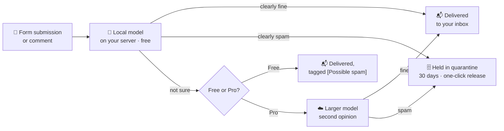

<div align="center">

# Local AI Anti-Spam

### Spam filtering for WordPress forms and comments, run by a machine-learning model on *your own server*.

**No CAPTCHA · No API key · No check limits · Nothing sent off your site**

[](https://github.com/aadilsal/Local-AI-Anti-Spam/actions/workflows/ci.yml)
[](#project-status)
[](#license)
[](#requirements)
[](#requirements)
[](#integrations)
[](#integrations)

[Status](#project-status) · [How it works](#how-it-works) · [Try it](#try-it) · [FAQ](#faq) · [For developers](#for-developers) · [The ML](#under-the-hood-the-model) · [Docs](document/README.md)

</div>

---

## Project status

**Beta (0.1.0).** The free plugin works end to end with Contact Form 7, WPForms and WordPress comments, and every push is tested in a real WordPress install. It is **not yet in the WordPress.org directory**.

The one thing missing before a public launch is a measurement on **real** contact-form traffic. All model numbers on this page come from public datasets and synthetic messages; real-world numbers, with confidence intervals, will be published once enough consented beta messages have been labelled. If you run a site with a busy contact form, [volunteer as a beta site](../../issues).

## The problem

Contact-form spam has changed. Spam operations now use cheap language models to write **unique, fluent, believable enquiries**: SEO pitches, fake quote requests, crypto and backlink offers. These messages pass CAPTCHA and slip past honeypots and keyword rules.

The tools that *can* read them, such as Akismet, CleanTalk and ActiveLayer, all do it in their own cloud. Every message your visitors write gets sent to a third party, and you pay **per check**.

## The fix

Local AI Anti-Spam puts a small, purpose-built machine-learning model **inside the plugin**. Every submission is scored on your own server, in a few milliseconds, at no cost per check.

- 🛡️ **Reads the message, not just the bot.** It is trained to tell a real enquiry from a fluent sales pitch or generated spam.
- 🏠 **Runs on your hosting.** No account, no API key, no outbound requests. Your visitors' messages never leave your site.
- ♾️ **Unlimited checks.** A busy site and a quiet site cost the same: nothing.
- 📥 **Never loses a lead.** Spam is *held* for 30 days, never deleted on arrival. One click releases a message exactly as it would have been delivered, notification email included.
- 💬 **Explains itself.** Every held message shows its score and the words that drove the verdict.
- ⚙️ **Zero setup.** Activate it, and it detects your form plugins and protects them. There is no wizard.

## How it works



1. A visitor submits your Contact Form 7 or WPForms form, or leaves a comment.
2. The plugin checks your allow and block lists, then scores the message with the built-in model, all in plain PHP.
3. Clear cases are settled on your server. Unsure cases are delivered with a tag (free), or get a second opinion from a larger model (Pro).
4. If anything goes wrong, such as a missing model file or an error, the message is **delivered**. It fails open, always.

## Try it

The beta isn't in the WordPress.org directory yet, so install it from a build:

```bash
git clone https://github.com/aadilsal/Local-AI-Anti-Spam.git
cd Local-AI-Anti-Spam/plugin
php bin/build-zip.php          # writes dist/local-ai-anti-spam.zip (needs PHP 7.4+ with zip)
```

Then in WordPress: **Plugins → Add New → Upload Plugin**, choose the zip, activate. Protection starts at once for every supported form plugin it finds; held messages appear under **Anti-Spam → Quarantine**.

## Why it's different

| | **Local AI Anti-Spam** | Akismet | CleanTalk | ActiveLayer | Antispam Bee |
|---|:---:|:---:|:---:|:---:|:---:|
| Understands fluent, AI-written spam | ✅ ML model | ✅ cloud | ✅ cloud | ✅ cloud AI | ⚠️ rules |
| Runs on your own server | ✅ | ❌ | ❌ | ❌ | ✅ |
| Messages stay on your site | ✅ | ❌ | ❌ | ❌ | ✅ |
| No account or API key | ✅ | ❌ | ❌ | ❌ | ✅ |
| Unlimited checks, free | ✅ | Non-commercial sites only | ❌ | 200 checks, once | ✅ |
| Paid plans from | $39/year (optional) | $9.95/month for 500 checks | $12/year per site | $4/month for 5,000 checks | Free |

<sub>Competitor details from vendor pages and third-party reviews, 2025–2026. Check current pricing on each vendor's site.</sub>

**Our honest position:** we don't claim to out-muscle Akismet's network on raw cloud accuracy. We offer private, unlimited, good-enough-for-most-sites filtering with no strings attached, and a paid second opinion if you want more.

## Free vs Pro

The free plugin is complete on its own: no locked features, no nag screens, no trial timer. **Pro and Agency are planned, not built yet**; the table shows what they will add.

| | Free | Pro *(planned)* | Agency *(planned)* |
|---|:---:|:---:|:---:|
| Local ML filtering, unlimited checks | ✅ | ✅ | ✅ |
| Contact Form 7, WPForms, comments | ✅ | ✅ | ✅ |
| Gravity Forms, Elementor, Fluent Forms *(planned)* | ✅ | ✅ | ✅ |
| Quarantine with one-click release | ✅ | ✅ | ✅ |
| "Why was this held?" explanations | ✅ | ✅ | ✅ |
| Allow and block lists (email, domain, IP, phrase), with "always allow" after a release | ✅ | ✅ | ✅ |
| Email digest of held messages | ✅ | ✅ | ✅ |
| Dashboard widget | ✅ | ✅ | ✅ |
| **Cloud second opinion** on borderline messages | | ✅ | ✅ |
| **Sales-pitch folder**: catches human-written SEO and web-design pitches | | ✅ | ✅ |
| Per-site learning | | ✅ | ✅ |
| Weekly summary email you can forward to a client | | ✅ | ✅ |
| **One dashboard for all your client sites** | | | ✅ |
| Sites | Unlimited | 1 | Unlimited (fair use: 50,000 cloud checks/month) |
| **Price** | **$0** | **$39/year** or $4.99/month | **$99/year** |

Pro only ever sends the *borderline* messages to our server. Clear cases still never leave your site. Message text is processed in memory and not stored. 14-day refund, no questions asked.

## Built for

- **🏪 Small-business owners**: install it and forget it. Spam disappears, and if a real customer is ever held by mistake, the digest and the "lowest score first" quarantine view make sure you see them.
- **🧑‍💻 Freelance developers**: one plugin for every form plugin your clients use, and no accounts to create per site.
- **🏢 Agencies**: one licence for every client site, one dashboard to prove it's working, and a smaller bill than per-site cloud plans.

## Privacy

Privacy is the reason this plugin exists, so the rules are strict and enforced by tests:

- The free plugin makes **no outbound network requests**. (Opt-in sharing of corrections to improve the model is planned; it will be off by default and redact emails, phone numbers and names before anything is sent.)
- Held messages are deleted automatically after your retention period (default 30 days).
- Uninstalling removes every table and setting the plugin created.
- It supports WordPress's built-in personal-data export and erase tools, and adds suggested text to your privacy policy page.
- The Pro cloud service does not log message content. A data-processing agreement is available for EU and UK customers.

## Requirements

- WordPress **6.0** or later
- PHP **7.4** or later. Only standard extensions are needed: no `mbstring`, `intl` or `curl` required.
- Works on ordinary shared hosting. The model file is 2.1 MB. Measured on a desktop PC (PHP 8.3), the worst case, an 8 KB message, takes 3.5 ms (p95) and 8.1 MB of extra memory; CI enforces a budget of 20 ms and 16 MB.

## Integrations

| Form plugin | Status | Notes |
|---|---|---|
| Contact Form 7 | ✅ Supported (tested with 6.2) | Held visitors see CF7's usual error message. Release rebuilds CF7's own email; uploaded files can't be resent because CF7 deletes them |
| WPForms | ✅ Supported (tested with Lite 2.0) | Held visitors see the normal confirmation. Release re-sends the form's own notifications |
| WordPress comments | ✅ Supported | Spam goes to WordPress's Spam list; logged-in users are trusted |
| Gravity Forms, Elementor Forms, Fluent Forms | 🗓️ Planned | |
| Ninja Forms, Formidable, Jetpack Forms | 🗓️ Later | |

Want another one? [Open an issue](../../issues) with the plugin name.

## FAQ

<details>
<summary><b>Is this a good Akismet alternative for commercial sites?</b></summary>

Yes, that is exactly who it's for. Akismet's free plan is for non-commercial sites only, and paid plans are metered per check. Local AI Anti-Spam is free for commercial sites, with unlimited checks, because the model runs on your own server.
</details>

<details>
<summary><b>How do I stop Contact Form 7 spam without a CAPTCHA?</b></summary>

Install and activate the plugin. It hooks into Contact Form 7's own spam check, scores each submission with the local model, and holds spam in a quarantine you can review. Your visitors never see a puzzle.
</details>

<details>
<summary><b>What if it blocks a real customer?</b></summary>

Nothing is deleted on arrival. Held messages stay in quarantine for 30 days (adjustable), sorted so the ones most likely to be real are at the top. An optional email digest lists them. Click **Not spam** and the message is delivered exactly as it would have been, notification email included, and you can choose to always allow that sender.
</details>

<details>
<summary><b>Does it slow down my site?</b></summary>

No. The model loads only when a form is submitted, never on normal page views. Each check is designed to take under 20 ms.
</details>

<details>
<summary><b>Does it work with my caching or security plugin?</b></summary>

It should: it runs inside your form plugin's own spam check, on form submission (a POST request), which page caches don't serve. If you find a conflict, please open an issue.
</details>

<details>
<summary><b>What languages does it support?</b></summary>

English only for now. Messages in other languages are delivered and labelled "not checked", never blocked by guesswork. More languages are planned.
</details>

<details>
<summary><b>Can spammers beat a model whose weights are public?</b></summary>

A determined spammer can tune messages against any public model. In practice the model also looks at links, domains and sender details that spam can't easily hide, and model updates ship with normal plugin updates. Pro's cloud model is not public.
</details>

## For developers

The plugin exposes a small, stable API (semver), and the Pro add-on uses exactly the same hooks.

```php
// Classify any text: no side effects, nothing stored.
$result = laas_classify( 'Hi! We can get your site to page 1 of Google…' );
// [ 'label' => 'spam', 'score' => 0.99, 'reason' => 'model',
//   'model_version' => 'local-baseline-20261107-0958', 'top_features' => [...] ]

// Never quarantine messages from your own domain.
add_filter( 'laas_verdict', function ( $verdict, $submission ) {
    $own = '@mycompany.example';
    if ( $submission->email && substr( $submission->email, -strlen( $own ) ) === $own ) {
        $verdict->label  = 'clean';
        $verdict->reason = 'custom';
    }
    return $verdict;
}, 10, 2 );

// React to held messages (e.g. post to Slack).
add_action( 'laas_quarantined', function ( $item_id, $verdict, $submission ) { /* … */ }, 10, 3 );
```

Filters: `laas_pre_classify`, `laas_score`, `laas_thresholds`, `laas_verdict`, `laas_quarantine_capability`. Actions: `laas_classified`, `laas_quarantined`, `laas_released`. Details in [architecture.md §9](document/architecture.md#9-public-developer-api-f17). Names use the working `laas_` prefix and may change before the first public release.

### Working on the code

| | |
|---|---|
| Plugin (`plugin/`) | `composer install`, then `composer test` (PHPUnit) and `composer lint` (WordPress coding standards, PHP 7.4 syntax). `php tests/bench/inference-bench.php model/model.dat` checks the speed budget |
| Real WordPress (`plugin/`) | `npm ci --ignore-scripts`, then `npx wp-env start` (Docker) gives a site at `localhost:8888` with CF7 and WPForms. The end-to-end checks in `plugin/tests/wp/` are listed in [agents.md](document/agents.md#3-commands) |
| Training (`training/`) | `uv sync`, then `pytest`, `ruff check .` and `mypy`. Data building, generation and training commands are in [agents.md](document/agents.md#3-commands) |

CI runs all of this on every push: PHP 7.4, 8.1 and 8.3; the Python checks; and a WordPress job that installs CF7 and WPForms, sends real submissions, checks escaping, nonces and permissions over HTTP, and runs WordPress.org's Plugin Check.

## Under the hood: the model

This project is also an open, end-to-end ML case study: **dataset → training → evaluation → deployment in plain PHP**.

| | Local model (in the free plugin) | Cloud model (for Pro, trained, not deployed) |
|---|---|---|
| Type | Logistic regression on hashed word 1–2-grams + character 3–5-grams + link/sender features | Fine-tuned MiniLM-L6, multi-class over spam subtypes |
| Runs in | Pure PHP 7.4+, 2.1 MB weights file, no extensions | ONNX Runtime on CPU, 8-bit (23 MB) |
| Training data | 96,549 rows from licence-checked public datasets and the training split of a ~50,000-message synthetic contact-form set, generated locally (Qwen2.5-7B, Phi-4-mini) | Same |
| Genuine messages held, synthetic test set | **0.33%** (95% CI 0.19–0.58%) | **0.17%** (95% CI 0.08–0.36%) |
| Spam caught at that rate | **90.5%** | **91.0%** |
| Target on *real* enquiries (PRD gate) | ≤ 0.5% held, ≥ 85% caught | ≤ 0.3% held, ≥ 95% caught |

Measured numbers are from the [training log](document/training-log.md) and [eval report](training/eval/report.md). They are **not** the shipping gate: that needs a hand-labelled set of real contact-form messages, which is being collected.

Some of the interesting engineering:

- **Exact parity between Python and PHP.** A custom featurizer uses `crc32` hashing (identical in both languages) and locale-free normalisation. Shared fixtures prove PHP and Python agree to four decimal places, on a test model and on the model that ships.
- **2 MB of weights, about 8 MB of memory.** PHP never unpacks the weights into an array. It reads only the few hundred buckets a message touches, straight from the binary file.
- **Leak-free evaluation.** Splits are grouped by source and by synthetic template, so test styles are never seen in training; the training log records the bugs this caught.
- **Generator-style confound handled.** Synthetic text is reweighted so the generator's writing style can't become a spam signal, and rule-based checks drop generated rows whose text contradicts their label.
- **Quantisation that keeps its accuracy.** Per-channel int8 cut the cloud model's recall loss from 2–3 points to under 0.4, at a quarter of the size.
- **Licence-clean data.** Every training row records its source and licence; only permissively licensed rows can reach training, enforced in code ([LICENCES.md](training/LICENCES.md)).
- **Trained on one desktop GPU** (RTX 2060, 6 GB), including the synthetic data generation.

Planned: distilling the cloud model into the local one, and dataset and model cards on Hugging Face.

## Roadmap

- [x] **Data foundation:** licence audit, public data rebuilt from source, synthetic generator running on a local GPU.
- [x] **Models v1:** local and cloud models trained and evaluated (on public and synthetic data).
- [x] **Free plugin:** PHP inference with parity tests; Contact Form 7, WPForms, comments; quarantine, rules, digest, dashboard widget, privacy tools; WordPress.org Plugin Check clean of errors.
- [ ] **Real test set:** 500 hand-labelled contact-form messages from beta sites, then the PRD gates. *(In progress: needs beta sites.)*
- [ ] **Launch:** submit to WordPress.org once the gates pass.
- [ ] **Pro:** cloud API, Pro add-on, product site.
- [ ] **Reach:** Gravity Forms, Elementor, Fluent Forms; distilled local model v2.
- [ ] **Later:** opt-in corrections, sales-pitch folder, agency dashboard, model v3 on consented real data.

<sub>Timings depend on things outside our control, mainly real-world data arriving and the WordPress.org review queue.</sub>

## Repository layout

```
plugin/          Free WordPress plugin (GPLv2+): what ships to WordPress.org
  src/             Inference (pure PHP), classifier pipeline, integrations, quarantine, rules, admin
  model/           model.dat: the exported local model
  tests/           PHPUnit unit tests, wp-env end-to-end checks, latency benchmark
training/        Python: data building, synthetic generation, featurizer, training, export
parity/          Shared PHP ↔ Python test fixtures
document/        PRD, architecture, design, security analysis, training log, release steps
```

Planned folders: `pro/` (Pro add-on), `cloud-api/` (FastAPI + ONNX Runtime), `inference-php/` (standalone PHP library), `site/` (product website).

## Documentation

| | |
|---|---|
| [Product requirements](document/PRD.md) | What we're building, for whom, and how we'll know it works |
| [Architecture essentials](document/architecture-essentials.md) | The whole system on one page |
| [Architecture](document/architecture.md) | Components, model format, integrations, cloud, training |
| [Design](document/design.md) | Screens, flows, copy, accessibility |
| [Security analysis](document/security-analysis.md) | Threat model and controls |
| [Training log](document/training-log.md) | Every data build and model run, with results and the bugs found |
| [Release steps](document/release.md) | Build, checks, beta and WordPress.org release |
| [Contributor and agent guide](document/agents.md) | Commands, rules and conventions for working in this repo |

## Contributing

- **Run a WordPress site with a busy contact form?** Real, consented examples of spam and genuine enquiries are the most valuable thing this project needs. [Open an issue](../../issues) to volunteer as a beta site.
- **Found a bug, or a design or security problem?** Issues and PRs are welcome.
- Please read [document/agents.md](document/agents.md) before opening a code PR; CI must pass.

Security issues: please report privately (see `SECURITY.md`, published with the first release) rather than in a public issue.

## License

- Plugin code and the PHP inference library: **GPLv2 or later**, as WordPress.org requires.
- Model weights: published openly with each release.
- Training datasets keep their original licences, listed with their attributions in [training/LICENCES.md](training/LICENCES.md) and the plugin's `readme.txt` (for example, the UCI SMS and YouTube spam collections are CC BY 4.0).

<div align="center">
<sub>Built by Aadil Salman Butt. Local, private spam filtering that is unlimited and free to run.</sub>
</div>
