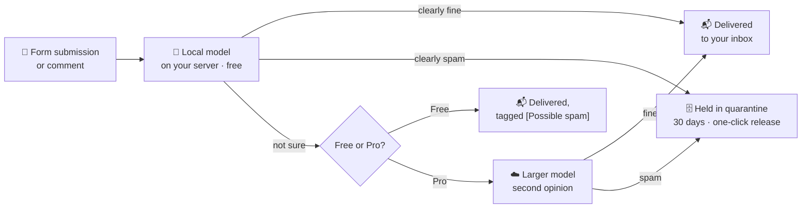

<div align="center">

# Local AI Anti-Spam

### Spam filtering for WordPress forms and comments, run by a machine-learning model on *your own server*.

**No CAPTCHA · No API key · No check limits · Nothing sent off your site**

[](#roadmap)
[](#license)
[](#requirements)
[](#requirements)
[](#integrations)
[](#integrations)

[How it works](#how-it-works) · [Why it's different](#why-its-different) · [Free vs Pro](#free-vs-pro) · [FAQ](#faq) · [For developers](#for-developers) · [The ML](#under-the-hood-the-model) · [Docs](document/README.md)

</div>

---

> **Project status:** in active development, and not yet in the WordPress.org directory. The accuracy figures on this page are **launch targets**, not measured results. Real numbers will be published here, with confidence intervals, once the model has been evaluated on real contact-form messages. ⭐ Star or watch the repo to hear when it launches.

## The problem

Contact-form spam has changed. Spam operations now use cheap language models to write **unique, fluent, believable enquiries**: SEO pitches, fake quote requests, crypto and backlink offers. These messages pass CAPTCHA and slip past honeypots and keyword rules.

The tools that *can* read them, such as Akismet, CleanTalk and ActiveLayer, all do it in their own cloud. Every message your visitors write gets sent to a third party, and you pay **per check**.

## The fix

Local AI Anti-Spam puts a small, purpose-built machine-learning model **inside the plugin**. Every submission is scored on your own server, in a few milliseconds, at no cost per check.

- 🛡️ **Reads the message, not just the bot.** It is trained to tell a real enquiry from a fluent sales pitch or generated spam.
- 🏠 **Runs on your hosting.** No account, no API key, no outbound requests. Your visitors' messages never leave your site.
- ♾️ **Unlimited checks.** A busy site and a quiet site cost the same: nothing.
- 📥 **Never loses a lead.** Spam is *held* for 30 days, never deleted on arrival. One click releases a message exactly as it would have been delivered, notification email included.
- 💬 **Explains itself.** Every held message shows its score and the words that drove the verdict.
- ⚙️ **Zero setup.** Activate it, and it detects your form plugins and protects them. There is no wizard.

## How it works



1. A visitor submits your Contact Form 7 or WPForms form, or leaves a comment.
2. The plugin checks your allow and block lists, then scores the message with the built-in model, all in plain PHP.
3. Clear cases are settled on your server. Unsure cases are delivered with a tag (free), or get a second opinion from a larger model (Pro).
4. If anything goes wrong, such as a missing model file or an error, the message is **delivered**. It fails open, always.

## Why it's different

| | **Local AI Anti-Spam** | Akismet | CleanTalk | ActiveLayer | Antispam Bee |
|---|:---:|:---:|:---:|:---:|:---:|
| Understands fluent, AI-written spam | ✅ ML model | ✅ cloud | ✅ cloud | ✅ cloud AI | ⚠️ rules |
| Runs on your own server | ✅ | ❌ | ❌ | ❌ | ✅ |
| Messages stay on your site | ✅ | ❌ | ❌ | ❌ | ✅ |
| No account or API key | ✅ | ❌ | ❌ | ❌ | ✅ |
| Unlimited checks, free | ✅ | Non-commercial sites only | ❌ | 200 checks, once | ✅ |
| Paid plans from | $39/year (optional) | $9.95/month for 500 checks | $12/year per site | $4/month for 5,000 checks | Free |

<sub>Competitor details from vendor pages and third-party reviews, 2025–2026. Check current pricing on each vendor's site.</sub>

**Our honest position:** we don't claim to out-muscle Akismet's network on raw cloud accuracy. We offer private, unlimited, good-enough-for-most-sites filtering with no strings attached, and a paid second opinion if you want more.

## Free vs Pro

The free plugin is complete on its own: no locked features, no nag screens, no trial timer.

| | Free | Pro | Agency |
|---|:---:|:---:|:---:|
| Local ML filtering, unlimited checks | ✅ | ✅ | ✅ |
| Contact Form 7, WPForms, comments | ✅ | ✅ | ✅ |
| Gravity Forms, Elementor, Fluent Forms *(soon after launch)* | ✅ | ✅ | ✅ |
| Quarantine with one-click release | ✅ | ✅ | ✅ |
| "Why was this held?" explanations | ✅ | ✅ | ✅ |
| Allow and block lists that learn from your corrections | ✅ | ✅ | ✅ |
| Email digest of held messages | ✅ | ✅ | ✅ |
| Dashboard widget | ✅ | ✅ | ✅ |
| **Cloud second opinion** on borderline messages | | ✅ | ✅ |
| **Sales-pitch folder**: catches human-written SEO and web-design pitches | | ✅ | ✅ |
| Per-site learning | | ✅ | ✅ |
| Weekly summary email you can forward to a client | | ✅ | ✅ |
| **One dashboard for all your client sites** | | | ✅ |
| Sites | Unlimited | 1 | Unlimited (fair use: 50,000 cloud checks/month) |
| **Price** | **$0** | **$39/year** or $4.99/month | **$99/year** |

Pro only ever sends the *borderline* messages to our server. Clear cases still never leave your site. Message text is processed in memory and not stored. 14-day refund, no questions asked.

## Built for

- **🏪 Small-business owners**: install it and forget it. Spam disappears, and if a real customer is ever held by mistake, the digest and the "lowest score first" quarantine view make sure you see them.
- **🧑‍💻 Freelance developers**: one plugin for every form plugin your clients use, and no accounts to create per site.
- **🏢 Agencies**: one licence for every client site, one dashboard to prove it's working, and a smaller bill than per-site cloud plans.

## Privacy

Privacy is the reason this plugin exists, so the rules are strict and enforced by tests:

- The free plugin makes **no outbound network requests**, unless you choose to share corrections to help improve the model. That is off by default, explained in plain words, and redacts emails, phone numbers and names before anything is sent.
- Held messages are deleted automatically after your retention period (default 30 days).
- Uninstalling removes every table and setting the plugin created.
- It supports WordPress's built-in personal-data export and erase tools, and adds suggested text to your privacy policy page.
- The Pro cloud service does not log message content. A data-processing agreement is available for EU and UK customers.

## Requirements

- WordPress **6.0** or later
- PHP **7.4** or later. Only standard extensions are needed: no `mbstring`, `intl` or `curl` required.
- Works on ordinary shared hosting. The model file is under 3 MB, and a check is designed to take under 20 ms and under 16 MB of memory.

## Integrations

| Form plugin | Status |
|---|---|
| Contact Form 7 | 🛠️ At launch |
| WPForms | 🛠️ At launch |
| WordPress comments | 🛠️ At launch |
| Gravity Forms | 🗓️ Within two months of launch |
| Elementor Forms | 🗓️ Within two months of launch |
| Fluent Forms | 🗓️ Within two months of launch |
| Ninja Forms, Formidable, Jetpack Forms | 🗓️ Later |

Want another one? [Open an issue](../../issues) with the plugin name.

## FAQ

<details>
<summary><b>Is this a good Akismet alternative for commercial sites?</b></summary>

Yes, that is exactly who it's for. Akismet's free plan is for non-commercial sites only, and paid plans are metered per check. Local AI Anti-Spam is free for commercial sites, with unlimited checks, because the model runs on your own server.
</details>

<details>
<summary><b>How do I stop Contact Form 7 spam without a CAPTCHA?</b></summary>

Install and activate the plugin. It hooks into Contact Form 7's own spam check, scores each submission with the local model, and holds spam in a quarantine you can review. Your visitors never see a puzzle.
</details>

<details>
<summary><b>What if it blocks a real customer?</b></summary>

Nothing is deleted on arrival. Held messages stay in quarantine for 30 days (adjustable), sorted so the ones most likely to be real are at the top. An optional email digest lists them. Click **Not spam** and the message is delivered exactly as it would have been, notification email included, and you can choose to always allow that sender.
</details>

<details>
<summary><b>Does it slow down my site?</b></summary>

No. The model loads only when a form is submitted, never on normal page views. Each check is designed to take under 20 ms.
</details>

<details>
<summary><b>Does it work with my caching or security plugin?</b></summary>

It should: it runs inside your form plugin's own spam check, on form submission (a POST request), which page caches don't serve. If you find a conflict, please open an issue.
</details>

<details>
<summary><b>What languages does it support?</b></summary>

English at launch. Messages in other languages are delivered and labelled "not checked", never blocked by guesswork. More languages are planned after launch.
</details>

<details>
<summary><b>Can spammers beat a model whose weights are public?</b></summary>

A determined spammer can tune messages against any public model. In practice the model also looks at links, domains and sender details that spam can't easily hide, and model updates ship with normal plugin updates. Pro's cloud model is not public.
</details>

## For developers

The plugin exposes a small, stable API (semver), and the Pro add-on uses exactly the same hooks.

```php
// Classify any text: no side effects, nothing stored.
$result = laas_classify( 'Hi! We can get your site to page 1 of Google…' );
// [ 'label' => 'spam', 'score' => 0.97, 'reason' => 'model',
//   'model_version' => 'local-2026.11.1', 'top_features' => [...] ]

// Never quarantine messages from your own domain.
add_filter( 'laas_verdict', function ( $verdict, $submission ) {
    $own = '@mycompany.example';
    if ( $submission->email && substr( $submission->email, -strlen( $own ) ) === $own ) {
        $verdict->label  = 'clean';
        $verdict->reason = 'custom';
    }
    return $verdict;
}, 10, 2 );

// React to held messages (e.g. post to Slack).
add_action( 'laas_quarantined', function ( $item_id, $verdict, $submission ) { /* … */ }, 10, 3 );
```

The full hook list is in [architecture.md §9](document/architecture.md#9-public-developer-api-f17). Names use the working `laas_` prefix and may change before the first release.

## Under the hood: the model

This project is also an open, end-to-end ML case study: **dataset → training → evaluation → deployment in plain PHP**.

| | Local model (free) | Cloud model (Pro) |
|---|---|---|
| Type | Logistic regression on hashed word 1–2-grams + character 3–5-grams + link/sender features | Fine-tuned small transformer (MiniLM-L6), multi-class over spam subtypes |
| Runs in | Pure PHP 7.4+, ≤ 3 MB weights file, no extensions | ONNX Runtime, 8-bit quantised, on CPU |
| Calibrated | Yes: a score of 0.9 means about 90% of messages at that score are spam | Yes |
| Target false-positive rate on real enquiries | ≤ 0.5% | ≤ 0.3% |
| Target spam recall at that rate | ≥ 85% *(estimate)* | ≥ 95% *(estimate)* |

Some of the interesting engineering:

- **Bit-exact parity between Python and PHP.** A custom featurizer uses `crc32` hashing (identical in both languages) and locale-free normalisation. A shared fixture suite proves PHP and Python agree to four decimal places.
- **2 MB of weights, about 2 MB of memory.** PHP never unpacks the weights into an array. It reads only the few hundred buckets a message touches, straight from the binary file.
- **Leak-free evaluation.** Splits are grouped by source and by synthetic template. Every metric is reported on a hand-labelled set of *real* contact-form messages, with confidence intervals, never on the easy public benchmarks.
- **Distillation.** From v2, the local model also learns from the cloud model's soft labels.
- **Licence-clean data.** Every training row records its source and licence, so any dataset can be pulled and the model retrained.

The dataset card, model card and evaluation reports will be published on Hugging Face at launch.

## Roadmap

- [ ] **Weeks 1–2: data foundation.** Licence audit, synthetic data generator, 500 real messages hand-labelled, baseline model.
- [ ] **Weeks 3–4: models v1.** Merged dataset on Hugging Face, transformer fine-tuned, evaluation report, final gates.
- [ ] **Weeks 3–6: free plugin.** PHP inference passing parity tests; Contact Form 7, WPForms, comments; quarantine; submitted to WordPress.org.
- [ ] **~Week 9: launch.** Live in the directory once WordPress.org review completes; Pro on sale.
- [ ] **Weeks 10–13:** Gravity Forms, Elementor, Fluent Forms; distilled local model v2.
- [ ] **Weeks 14–19:** opt-in corrections, sales-pitch folder, per-form-plugin guides.
- [ ] **Weeks 20–26:** agency dashboard; model v3 trained on consented real data (once enough has been shared).

<sub>Timings depend on things outside our control, mainly real-world data arriving and the WordPress.org review queue.</sub>

## Repository layout

```
plugin/          Free WordPress plugin (GPLv2+): what ships to WordPress.org
pro/             Pro add-on
inference-php/   Standalone PHP inference library
training/        Python: dataset, featurizer, training, export, evaluation
parity/          Shared PHP ↔ Python test fixtures
cloud-api/       FastAPI + ONNX Runtime classification service
site/            Product website
document/        PRD, architecture, design, security analysis, contributor guide
```

## Documentation

| | |
|---|---|
| [Product requirements](document/PRD.md) | What we're building, for whom, and how we'll know it works |
| [Architecture essentials](document/architecture-essentials.md) | The whole system on one page |
| [Architecture](document/architecture.md) | Components, model format, integrations, cloud, training |
| [Design](document/design.md) | Screens, flows, copy, accessibility |
| [Security analysis](document/security-analysis.md) | Threat model and controls |
| [Contributor and agent guide](document/agents.md) | Commands, rules and conventions for working in this repo |

## Contributing

Contributions are welcome once the first code lands. In the meantime:

- **Run a WordPress site with a busy contact form?** Real, consented examples of spam and genuine enquiries are the most valuable thing this project needs. [Open an issue](../../issues) to volunteer as a beta site.
- **Found a design or security problem in the docs?** Issues and PRs are welcome.
- Please read [document/agents.md](document/agents.md) before opening a code PR.

Security issues: please report privately (see `SECURITY.md`, published with the first release) rather than in a public issue.

## License

- Plugin code and the PHP inference library: **GPLv2 or later**, as WordPress.org requires.
- Model weights: published openly with each release.
- Training datasets keep their original licences, listed in the dataset card (for example, the UCI SMS and YouTube spam collections are CC BY 4.0).

<div align="center">
<sub>Built by Aadil Salman Butt. Local, private spam filtering that is unlimited and free to run.</sub>
</div>
