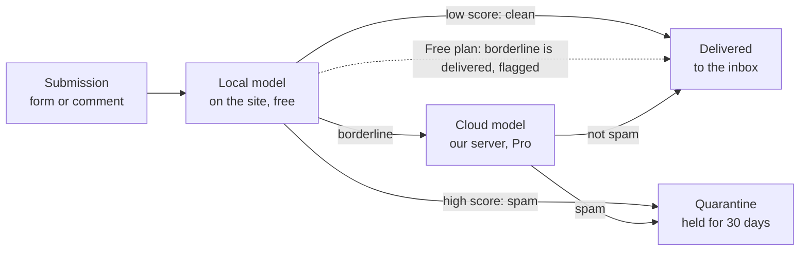

# PRD: Local ML Anti-Spam Plugin for WordPress

| | |
|---|---|
| **Owner** | Aadil Salman Butt |
| **Date** | 10 October 2026 |
| **Status** | Approved for build: month 1 (data foundation) |
| **Working name** | Local AI Anti-Spam (slug `local-ai-anti-spam`, still to be confirmed; see Open questions) |
| **Source** | `PRD Local ML Anti-Spam Plugin for WordPress.pdf`, converted to Markdown |

> **Changes from the PDF.** The content is the same. Two edits make it easier to work with:
> 1. Pro requirements are renamed **PRO-1 … PRO-10** (they were P1 … P10). The old IDs clashed with the priority labels P0/P1/P2, so "P1 is P0" meant two different things.
> 2. An appendix, **Review notes**, lists inconsistencies and technical risks found while converting. Nothing in the main body was changed to resolve them. Those decisions stay with the owner.

---

## 1. Summary

A WordPress plugin that sorts contact-form submissions and comments into **spam** or **not spam**, using a machine-learning model that runs on the site's own server. The free version needs no API key, has no check limits and sends no data off the site. A paid Pro tier adds a larger hosted model for borderline cases, plus agency features.

- **Who it is for:** small-business WordPress site owners, and the freelancers and agencies who maintain their sites.
- **Why now:** spam written by language models passes CAPTCHA and honeypots, and every ML-based competitor is cloud-only and metered per check.
- **Revenue target:** $500/month by month 12, about 125 paying sites. The realistic base case is $100–250/month.
- **Builder constraints:** one developer, about 20 hours a week, running costs of $20/month or less, training on an RTX 2060 with 6 GB of VRAM, and no active marketing.
- **Core asset:** the model and the merged dataset are our own. No third-party LLM API sits in the request path.

## 2. Problem and evidence

Contact forms on small-business sites receive spam that looks like a real enquiry, and existing defences either miss it or charge per check. Real leads get buried, and a filter that is too aggressive silently drops real customers.

**The pain**

- Spam operations now generate unique, fluent, plausible enquiries with cheap language models. Stonegate Web Security's 2026 review of 135 submissions to one small-business form found these arriving with valid CAPTCHA tokens.
- The common types are SEO and development sales pitches, fake enquiries, and crypto or backlink spam.
- Keyword rules and honeypots stop simple bots but not fluent text.

**Proof that people pay**

- Akismet has 5,000,000+ installs and charges commercial sites from $9.95/month for 500 checks.
- CleanTalk has 200,000+ installs at $12/year per site.
- OOPSpam starts at $23/month.
- Awesome Motive, the company behind WPForms, launched ActiveLayer in 2026 to sell AI spam protection at $4/month.

**Why a chatbot does not solve it**

Nobody pastes every form submission into ChatGPT. The job has to run automatically on each submission, in milliseconds, at near-zero cost per call. That is the case for a small specialised model.

## 3. Goals, non-goals and success metrics

### Goals

1. Ship a free plugin that is complete on its own: local ML filtering, quarantine and one-click correction.
2. Keep real enquiries safe. A lost lead costs the user more than a missed spam message.
3. Earn recurring revenue from a Pro tier without any ongoing marketing.
4. Produce a credible ML portfolio piece: dataset, training, evaluation and deployment, all published.

### Non-goals for version 1

- IP reputation network, firewall or CAPTCHA.
- WooCommerce checkout or card-testing protection.
- Registration and login spam.
- Languages other than English. Other languages come after launch.
- Any promise of 24/7 support or an uptime guarantee.
- Platforms other than WordPress.

### Success metrics

| Metric | Target | When |
|---|---|---|
| False-positive rate on real enquiries (local model) | 0.5% or lower | Before launch, and every model release |
| Spam recall at that false-positive rate (local model) | 85% or higher (estimate, to confirm on the test set) | Before launch |
| Spam recall with cloud model on borderline cases | 95% or higher (estimate) | Pro launch |
| Local inference time on shared hosting | Under 20 ms per submission | Before launch |
| Active installs | 300 by 3 months after launch; 3,400+ by 8 months after launch | Ongoing |
| Paying sites | 3 by 4 months after launch; about 125 by 8 months after launch | Ongoing |
| Monthly revenue | $100 by 5 months after launch; $500 by 8 months after launch (stretch) | Ongoing |
| WordPress.org rating | 4.5 stars or higher | From 2 months after launch |
| Support threads answered within 48 hours | 90% or higher | Ongoing |
| Running cost | $20/month or lower | Ongoing |

## 4. Target users

Three users, in order of priority. The first drives installs, the third drives revenue.

| User | Situation | What they need | Likely plan |
|---|---|---|---|
| Small-business site owner | Runs one WordPress site with a contact form; not technical; checks the inbox daily | Spam gone without setup, and confidence that no real enquiry was lost | Free, some upgrade to Pro |
| Freelance developer | Maintains 5–20 client sites; installs the same plugins on each | Something that works with any form plugin, needs no account per site, and causes no support calls | Free on most sites, Pro on a few |
| Small agency | Maintains 20–200 client sites; pays per-site fees to Akismet or CleanTalk today | One licence for all sites, a single view of spam across them, and a lower bill | Agency |

**Jobs to be done**

- When a form submission arrives, decide whether it is spam before it reaches my inbox.
- When the filter is unsure or wrong, let me fix it in one click and have it remember.
- When I look after many sites, show me in one place that the filter is working.

## 5. Competitive positioning

No plugin today offers an ML classifier that runs on the site's own server with unlimited checks. Antispam Bee is local but rule-based. Every ML competitor is cloud-only and metered. The plugin takes the "local ML" position and sells a cloud model for hard cases.

| Product | Where it runs | Price (2026) | Scale | Weakness we use |
|---|---|---|---|---|
| Akismet | Cloud | Free for non-commercial sites only; $9.95/month for 500 checks | 5M+ installs | Expensive per check; content goes to a third party |
| CleanTalk | Cloud | $12/year per site; $27/month unlimited | 200k+ installs | No permanent free tier; depends on its servers |
| OOPSpam | Cloud API | $23/month for 25,000 checks | 3.5M+ sites (vendor claim) | Too much for one small site |
| ActiveLayer | Cloud AI | 200 free checks, one time; $4/month billed yearly for 5,000 | 10k+ installs | Metered; tiny free tier |
| Antispam Bee | Local rules | Free | 700k+ installs | Rule-based; weaker on fluent spam |

**Positioning statement:** local AI spam filtering for WordPress forms and comments, with no CAPTCHA, no API key and no check limits.

**What we will not compete on:** raw cloud accuracy against Akismet's network data, or distribution against ActiveLayer, which is promoted inside WPForms.

## 6. Free tier requirements

The free plugin must be fully useful without Pro. WordPress.org ranking and reviews depend on it, and the directory's rules forbid locking built-in features behind payment.

Priority: **P0** is required for launch, **P1** follows within two months of launch, **P2** is later.

| ID | Requirement | Priority |
|---|---|---|
| F1 | Classify each submission on the site's server with the bundled model. No network call, no account, no API key. | P0 |
| F2 | Return a spam score from 0 to 1 and a verdict of clean, borderline or spam, using two thresholds the user can adjust. | P0 |
| F3 | Contact Form 7 integration. | P0 |
| F4 | WPForms integration. | P0 |
| F5 | Native WordPress comments integration. | P0 |
| F6 | Quarantine: spam is stored, never deleted on arrival. Default retention 30 days, adjustable. | P0 |
| F7 | Quarantine screen in wp-admin: list, search, view full message, score, and the top words that drove the verdict. | P0 |
| F8 | One-click "Not spam" that releases the message to its original destination, and "Mark as spam" for misses. | P0 |
| F9 | Local learning from corrections: an allow-list and block-list of senders and phrases, applied before the model. | P0 |
| F10 | Works with defaults on activation. Setup takes zero required steps. | P0 |
| F11 | Runs on PHP 7.4+ and WordPress 6.0+ on shared hosting, with no PHP extensions beyond the standard set. | P0 |
| F12 | Fails open: if the model file is missing or errors, the submission is delivered and the error is logged. | P0 |
| F13 | Dashboard widget: counts of checked, blocked and released over the last 30 days. | P1 |
| F14 | Gravity Forms, Elementor Forms and Fluent Forms integrations. | P1 |
| F15 | Daily or weekly email digest of quarantined messages, so the owner can spot a wrongly blocked enquiry. | P1 |
| F16 | Opt-in, off by default: share corrected messages to improve the model, with clear consent text. | P1 |
| F17 | Developer filter hooks to override the score or verdict, and a public function to classify arbitrary text. | P1 |
| F18 | Model updates delivered with normal plugin updates. | P0 |
| F19 | Ninja Forms, Formidable and Jetpack Forms integrations. | P2 |
| F20 | Translation-ready strings. | P1 |

**Performance and size limits**

- Model file 3 MB or smaller.
- Classification under 20 ms and under 16 MB of extra memory per submission.
- No effect on front-end page load: the model loads only when a submission is processed.

## 7. Pro tier requirements

Pro sells accuracy on hard cases and time saved across many sites. Every Pro feature either calls our hosted service or ships in the separate Pro build, so the free plugin stays within directory rules.

| ID | Requirement | Priority |
|---|---|---|
| PRO-1 | Cloud second opinion: submissions the local model scores as borderline are sent to the hosted transformer model, which returns the final verdict. | P0 for Pro launch |
| PRO-2 | Only borderline submissions are sent. Clean and clear-spam verdicts stay local. | P0 |
| PRO-3 | Fails back to the local verdict if the cloud does not answer within 2 seconds. | P0 |
| PRO-4 | Solicitation class: detect sales pitches written by real people (SEO, web design, lead lists) as a category separate from bot spam, with its own on/off switch and its own folder. | P0 |
| PRO-5 | Licence activation and checks through Freemius. | P0 |
| PRO-6 | Per-site adaptation: corrections adjust that site's thresholds and local weights over time. | P1 |
| PRO-7 | Agency dashboard: one hosted page listing all licensed sites with counts of checked, blocked and released, and a link to each quarantine. | P1 |
| PRO-8 | Weekly summary email per site, suitable for forwarding to a client. | P1 |
| PRO-9 | Early model updates, ahead of the free release. | P2 |
| PRO-10 | Fair-use limit of 50,000 cloud checks per month on the Agency plan, with a warning at 80%. | P1 |

**Cloud service limits**

- Response time under 300 ms at the 95th percentile (estimate, to confirm under load).
- Submission text is processed in memory and not stored, unless the site has opted in to sharing corrections.

## 8. Key user flows

Four flows cover version 1. Each one must work without the user reading documentation.

**Install and first run**

1. The user installs the plugin from the WordPress.org directory and activates it.
2. The plugin detects which supported form plugins are active and turns on protection for each, plus comments.
3. A single notice confirms what is protected and links to the quarantine screen. No setup wizard.

**Reviewing the quarantine**

1. The user opens the quarantine screen from the admin menu or the email digest.
2. Each row shows the sender, the first line, the form it came from, the score and the reason.
3. The user opens a message to read it in full.
4. The user releases it, deletes it, or leaves it to expire.

**Correcting a mistake**

1. For a real enquiry in quarantine, the user clicks "Not spam".
2. The message is delivered exactly as the form plugin would have delivered it, including the notification email.
3. The plugin offers to always allow that sender.
4. For spam that got through, the user clicks "Mark as spam" from the form plugin's entry list or the comment list.
5. If the site has opted in, the corrected message is queued to share.

**Upgrading to Pro**

1. The settings screen shows how many borderline messages the last 30 days produced, which is what Pro would have re-checked.
2. The user clicks upgrade and pays in the Freemius checkout.
3. The licence activates on return, and the cloud second opinion and the solicitation class turn on.

**Edge cases to handle**

- Very short messages, under five words: score on sender and link features, and lean towards delivering.
- Non-English messages: deliver, and label them "not checked" in version 1.
- A form with no free-text field: skip classification.
- A burst of submissions: classification must not slow the form response beyond the 20 ms budget each.

## 9. ML requirements

Two models trained on one merged dataset: a small linear model that ships inside the plugin, and a fine-tuned transformer that serves Pro. The dataset is the weakest part of the plan, because no large, real contact-form spam corpus exists with a licence that allows commercial use.

### 9.1 Dataset

| Source | Size | Licence | Use |
|---|---|---|---|
| UCI SMS Spam Collection | 5,574 | CC BY 4.0 | Train: short-text spam patterns |
| UCI YouTube Spam Collection | 1,956 | CC BY 4.0 | Train: comment spam |
| Deysi/spam-detection-dataset | 10,900 | Apache-2.0 tag, provenance undocumented | Train with caution: fluent spam |
| Synthetic contact-form set, generated by us | 30,000–60,000 | Ours, if generated with an Apache-2.0 or MIT open-weights model | Train: main in-domain data |
| Hand-labelled real contact-form messages | 1,000–2,000 | Ours, collected with consent | **Test only**: the set every metric is reported on |
| Enron-Spam | 33,716 | Unclear | Evaluation only |
| SpamAssassin public corpus | 6,047 | Copyright stays with senders | Evaluation only |
| Opt-in user corrections | Grows after launch | Our consent terms | Train, from model v3 |

**Dataset requirements**

- **D1.** One shared schema: text, label (spam or ham), subtype (bot, solicitation, phishing, adult, crypto, enquiry, support), source, language.
- **D2.** Every row keeps its source, so any dataset can be removed and the model retrained if a licence question arises.
- **D3.** Exact and near-duplicate removal before splitting.
- **D4.** Train and test split by source and by synthetic template, so no template appears on both sides.
- **D5.** Sources marked evaluation-only never enter production training.
- **D6.** The synthetic set covers both spam and real enquiries across at least 20 business types, with varied length, tone and quality.
- **D7.** The redistributable part of the merged set is published on Hugging Face with a dataset card listing each source and licence.

### 9.2 Local model (free tier)

- **M1.** Hashed word 1–2-grams and character 3–5-grams feeding logistic regression, trained in scikit-learn.
- **M2.** Extra features: link count, link domains, ratio of capitals, message length, and whether the email domain matches the links.
- **M3.** Weights exported to a single file of 3 MB or less. Inference written in plain PHP, with a test suite that checks PHP and Python outputs match to four decimal places.
- **M4.** Scores are calibrated, so a threshold of 0.9 means about 90% of messages above it are spam.
- **M5.** Trained partly on the cloud model's soft labels (distillation) from model v2.

### 9.3 Cloud model (Pro tier)

- **M6.** Fine-tune a small encoder, MiniLM-L6 or ModernBERT-base, as a multi-class classifier over the subtypes.
- **M7.** Train on the RTX 2060 with mixed precision, batch size 16–32, sequence length 256. Use Kaggle's free GPU for parameter sweeps.
- **M8.** Export to ONNX and quantise to 8-bit integers. Accuracy loss from quantisation must be under 0.5 points of recall.
- **M9.** Serve on CPU with ONNX Runtime.

### 9.4 Evaluation gates

A model version ships only if it passes every gate on the hand-labelled real test set.

| Gate | Local model | Cloud model |
|---|---|---|
| False-positive rate on real enquiries | 0.5% or lower | 0.3% or lower |
| Spam recall at that rate | 85% or higher (estimate) | 95% or higher (estimate) |
| Calibration error | 5% or lower | 5% or lower |
| No regression against the previous version | Required | Required |
| Beats a keyword-rule baseline on recall | Required | Required |

The recall targets are estimates until the real test set exists. Set final numbers after the first baseline in month 1. SMS-spam accuracy is not reported as a headline, because every model scores near the ceiling on it.

## 10. Technical architecture

Free-tier classification runs entirely on the customer's server, so our cost stays at zero however many sites install it. Only Pro sites call our server, and only for borderline messages.

The local model settles clear cases on the site. On Pro, borderline messages get a second opinion from the cloud model; on the free plan they are delivered with a flag.

**Components**

| Component | Technology | Where it runs | Our cost |
|---|---|---|---|
| Free plugin | PHP, licensed GPLv2 or later | Customer's WordPress site | $0 |
| Local model | Hashed n-gram logistic regression; weights file; inference in plain PHP | Customer's site | $0 |
| Pro add-on | PHP, delivered through Freemius | Customer's site | $0 |
| Cloud API | FastAPI or Node service with ONNX Runtime and the 8-bit transformer | One small CPU server | About $5–10/month (estimate) |
| Licensing and checkout | Freemius SDK | Freemius | A fee per sale |
| Training pipeline | Python, scikit-learn, PyTorch, Hugging Face libraries | Own PC and Kaggle | $0 |
| Product site | Static pages | Free static host | Domain only |

**Technical requirements**

- **T1.** Each integration uses the form plugin's official spam hook, for example Contact Form 7's `wpcf7_spam` filter, Gravity Forms' `gform_entry_is_spam` and WordPress's `pre_comment_approved`. Confirm the hook for each plugin during design.
- **T2.** Quarantine lives in one custom database table, indexed by date and verdict, and is removed on uninstall.
- **T3.** The cloud API has one classification endpoint over HTTPS, authenticated by licence key and site URL. It returns the verdict, class scores and model version.
- **T4.** Verdicts are cached by message hash for 24 hours, so repeated spam costs one inference.
- **T5.** Requests are rate-limited per licence.
- **T6.** A free uptime monitor checks the API and alerts on failure.
- **T7.** Every stored verdict records the model version that produced it.
- **T8.** A parity test suite checks that PHP and Python inference agree, and WordPress's Plugin Check tool passes with no errors before each release.

**Capacity.** One server should cover thousands of Pro sites. OOPSpam's guidance puts an average site at 20–50 submissions a day, and we expect 10–20% of those to be borderline (estimate). Add a second server when peak CPU use passes 60%.

## 11. Pricing, licensing and payments

Three plans, sold through Freemius, which can pay out to Pakistan. Pricing sits above ActiveLayer's $48/year because local checks are unlimited, and far below Akismet's roughly $119/year for 500 checks a month.

| Plan | Price | Sites | Includes |
|---|---|---|---|
| Free | $0 | Unlimited | Local model, all integrations, quarantine, corrections, digest |
| Pro | $39/year, or $4.99/month | 1 | Free features plus cloud second opinion, solicitation class, per-site adaptation, weekly summary |
| Agency | $99/year | Unlimited, fair use of 50,000 cloud checks a month | Pro features plus the agency dashboard |

**Path to $500/month**

- About 110 Pro and 15 Agency subscriptions give roughly $5,775/year, or $480/month before fees.
- Freemius takes 3.8% plus $0.50 per sale, leaving about 93–94%.
- At a free-to-paid rate of 2–3.7%, that needs about 3,400–6,250 active installs. Freemius reports an average of 1.51% for plugins with free trials, so 2% is already above average.

**Payments**

- Freemius is the seller of record. It handles VAT and sales tax, and lets an individual sell without a company.
- Payout by Payoneer in USD, monthly, with a $100 minimum.
- Stripe does not support Pakistan-based businesses, so anything that depends on it is out.
- Backup routes are Lemon Squeezy with bank payout, and Paddle. Confirm both during sign-up.

**Licensing**

- Plugin code: GPLv2 or later, as WordPress.org requires.
- Model weights and the PHP inference library: published openly. The paid value is the hosted cloud model and the service, not secrecy.
- Refunds: 14 days, no questions asked.

## 12. Distribution

The WordPress.org plugin directory is the only acquisition channel. People already search it for "anti-spam" and "contact form spam", so installs arrive without marketing. Growth is slow at first and compounds as installs and reviews build.

**Listing requirements**

- **L1.** Plugin title in the pattern "Local AI Anti-Spam for Contact Form 7, WPForms and Comments: No CAPTCHA, No API Key".
- **L2.** Up to five tags, such as anti-spam, contact form spam, spam protection, comment spam, no captcha.
- **L3.** A short description that states the three differences: local, unlimited, no account.
- **L4.** FAQ entries answering the searches "Akismet alternative for commercial sites" and "stop Contact Form 7 spam".
- **L5.** Screenshots of the quarantine screen, the reason view and the dashboard widget.
- **L6.** A changelog entry for every model update, with its measured false-positive rate.

**One-time tasks, which Claude can draft**

- The readme and listing copy.
- About 20 pages on the product site, one per form plugin: "Stop spam in Gravity Forms" and so on.
- Submissions to "alternatives" directories such as AlternativeTo.
- One technical write-up: "A spam model that runs in plain PHP".

**The one ongoing task.** Answer every support thread on WordPress.org within 48 hours. Response rate and ratings feed directory ranking, and nothing else substitutes for it.

**Review queue.** New plugins wait for a manual review. The plugins team reported 4,611 plugins in the queue on 5 October 2026, most of them waiting on their authors. Submit code that already passes the Plugin Check tool, and plan for several weeks.

**Expected results at month 12 (estimates)**

| Scenario | Active installs | Monthly revenue |
|---|---|---|
| Pessimistic | 300–800 | $0–50 |
| Base | 1,500–3,000 | $100–250 |
| Optimistic | 4,000–7,000 | $450–700 |

## 13. Privacy, compliance and platform rules

Privacy is the product's main selling point, so these are requirements, not notes. This section is not legal advice; have the privacy text reviewed before launch.

**Privacy requirements**

- **C1.** The free plugin makes no outbound network calls of any kind unless the user turns on sharing.
- **C2.** Sharing corrections is opt-in and off by default. The consent text says exactly what is sent, where, and how to withdraw.
- **C3.** Shared messages have email addresses, phone numbers and names in form fields removed before they leave the site.
- **C4.** The cloud API processes text in memory and does not log message content.
- **C5.** Quarantined messages are deleted after the retention period, and all plugin data is removed on uninstall.
- **C6.** The plugin adds suggested text to the site's WordPress privacy policy page and supports WordPress's personal-data export and erase tools.
- **C7.** A data-processing agreement is available for Pro customers in the EU and UK.

**WordPress.org rules that shape the design**

- The free plugin cannot contain features that are locked until payment. Pro features must run on our service or ship in the separate Pro build.
- A plugin may act as the interface to a paid external service, provided the service does real work.
- No tracking or external calls without clear consent.
- All code in the directory must be GPL-compatible.

**Dataset licensing**

- Only sources cleared for commercial use enter production training. Each row keeps its source so a dataset can be pulled.
- Synthetic data is generated only with models whose licence places no conditions on outputs.
- Re-check every dataset licence before training the first production model.

## 14. Milestones and kill criteria

**Revised 10 Oct 2026 for AI-assisted development.** The original plan was twelve months of building at about 20 hours a week. With coding agents doing most of the implementation, the build is about six months to feature-complete, with launch at about week 9. External waits (real data, the WordPress.org review queue, Freemius) and organic growth don't compress, so the **business targets are anchored to the launch date**, with the same spacing as before. Week 1 starts when work begins.

| When | Milestone | Done when |
|---|---|---|
| Weeks 1–2 | Data foundation | Licences audited; synthetic generator working; 500 real messages hand-labelled; baseline linear model scored on them |
| Weeks 3–4 | Models v1 | Merged dataset v1 on Hugging Face; transformer fine-tuned; evaluation report written; gates set with real numbers |
| Weeks 3–6 | Free plugin built | PHP inference passes parity tests; Contact Form 7, WPForms and comments work; quarantine screen done; submitted to WordPress.org |
| ~Week 9 (review-dependent) | Launch | Plugin live in the directory; Freemius connected; cloud API running; Pro on sale |
| Weeks 10–13 | Reach | Gravity Forms, Elementor and Fluent Forms added; distilled local model v2 shipped |
| Weeks 14–19 | Learning loop | Opt-in corrections flowing; solicitation class live; per-form-plugin pages published |
| Weeks 20–26 | Agency | Agency dashboard live; model v3 trained on consented real data (once enough exists) |

**Business targets, from launch:** first paying customer within 2 months; $100/month by 5 months; $500/month (stretch) and 3,400+ installs by 8 months.

**Kill and pivot criteria**

- Fewer than 300 active installs 3 months after launch: narrow the listing to one form plugin, starting with Contact Form 7.
- Fewer than 3 paying customers 4 months after launch: make the plugin fully free as a portfolio piece, and sell the cloud model as a pay-per-use API on RapidAPI or Apify instead.
- Real-world false-positive rate above 1% after model v2: stop charging until it is fixed.
- Running cost above $20/month before revenue covers it: move the cloud model to a cheaper host or reduce what counts as borderline.

**Portfolio deliverables, whatever the revenue**

- Hugging Face model card with metrics on the real test set, the 8-bit versus full-precision comparison and response times.
- Hugging Face dataset card listing every source and licence.
- GitHub repositories for the training pipeline and the open PHP inference library.
- A write-up covering domain shift, leak-free splits, distillation and quantisation.

## 15. Risks and open questions

The largest risk is slow discovery, and it cannot be fully removed. The chance of $500/month by month 12 with no marketing is about 15–20%; the chance of $100/month or more is about 45–55%. Both are judgement estimates.

| Risk | Likelihood | Impact | Mitigation |
|---|---|---|---|
| Organic installs grow too slowly to reach 3,400 | High | High | Integrate with more form plugins, each adding a search term; answer all support threads; treat the portfolio value as the floor |
| ActiveLayer or Akismet cut prices or add a local mode | Medium | High | Compete on unlimited local checks and privacy, not cloud accuracy |
| Training data does not match real contact-form spam | High | High | Real hand-labelled test set from month 1; opt-in corrections from launch; honest published metrics |
| A real enquiry is blocked and a user loses a lead | Medium | High | Quarantine, never delete; conservative default thresholds; email digest; fail open |
| A dataset licence turns out to bar commercial use | Low | Medium | Source column on every row; retrain without it |
| The synthetic set teaches the model its generator's style | Medium | Medium | Several generator models and prompts; split by template; measure only on real data |
| WordPress.org review is delayed or rejects the plugin | Medium | Medium | Pass Plugin Check before submitting; no locked features in the free build |
| Support load exceeds the hours available | Medium | Medium | Zero-setup defaults; in-plugin explanations; FAQ |
| Payout route from Freemius changes | Low | High | Keep Lemon Squeezy and Paddle as tested backups |

**Open questions**

- [ ] Product name and plugin slug. Check the WordPress.org directory and trademarks first.
- [ ] Which open-weights model generates the synthetic set, and does its licence leave outputs unrestricted?
- [ ] Where do the first 500 real contact-form messages come from? Own sites, friends' sites or beta users.
- [ ] MiniLM-L6 or ModernBERT-base for the cloud model? Decide on the month 2 evaluation.
- [ ] Should the monthly plan exist at launch, or annual only?
- [ ] Which server provider gives the lowest price with a data centre in the EU?
- [ ] Is a free trial of Pro worth offering, given Freemius's conversion data?
- [ ] Does the solicitation class belong in Pro, or is it the feature that would drive free installs?

## 16. Sources

Figures come from the research report of 10 October 2026. Prices and install counts are from vendor pages and third-party reviews in 2025–2026: Akismet pricing, ActiveLayer pricing, Antispam Bee on WordPress.org, CleanTalk on WordPress.org, OOPSpam, Freemius supported countries, Freemius pricing, WordPress plugins team update (5 October 2026), UCI SMS Spam Collection, UCI YouTube Spam Collection.

---

## Appendix A. Review notes

Found while converting the PRD. Each note says where it applies and what it suggests. None of them changes a requirement until the owner accepts it.

| # | Where | Note | Suggested resolution |
|---|---|---|---|
| R1 | F11 + performance limits | A 3 MB float32 weights file unpacked into a PHP array holds about 786k elements at 16–32 bytes each, so about 13–25 MB plus the 3 MB raw string. That is at or over the 16 MB budget, and it would be paid on every submission. | Keep the weights as one packed binary string and read only the buckets a message touches. See [architecture.md §4](architecture.md#4-local-model-format-and-php-inference). |
| R2 | M1 + M3 | scikit-learn's `HashingVectorizer` uses MurmurHash3, and PHP 7.4 has no built-in Murmur. `strtolower` also depends on locale before PHP 8.2. | Write our own featuriser in Python and PHP with `crc32` (the same in both languages) and ASCII-only case folding. |
| R3 | PRO-5 + C1 | The Freemius SDK makes network calls. If it ships in the free build, the free plugin breaks C1 and may fail directory review. | Freemius ships only in the Pro add-on. The free plugin's upgrade button is a plain link to the checkout. |
| R4 | Evaluation gates | With 1,000 real enquiries in the test set, observing 0 false positives still leaves a 95% upper bound of about 0.3%, and 3 false positives gives about 0.9%. A 0.5% gate needs roughly 1,500 or more real enquiries (ham) to be meaningful. | Report Wilson 95% intervals, and grow the ham side of the test set first. |
| R5 | PRO-1/PRO-3 vs. "burst" edge case | A synchronous cloud call can add up to 2 s to the form response, which the 20 ms budget does not cover. | The 20 ms budget is for local inference only. Cloud calls apply only to borderline messages (about 10–20%), with a hard 2 s timeout. |
| R6 | F8 (CF7) | Contact Form 7 does not store submissions. Once the spam filter blocks a message, CF7 has nothing to re-send. | Quarantine stores the full posted data and the form ID, and release rebuilds the mail through CF7's mail templates. This is the riskiest integration to build. |
| R7 | F15 vs. pricing table | The digest is listed as a free feature (F15) and the weekly summary as Pro (PRO-8). The difference is whether a client can read it. | Keep both. The free digest goes to the admin and lists quarantined items. The Pro summary is branded and written for a client. |
| R8 | PRO-4 vs. pricing | The solicitation class is P0 for Pro launch (month 4), but the milestones put it in months 7–9. | Choose one. Suggestion: the cloud model predicts all subtypes from v1, and the solicitation folder and its UI ship in months 7–9. |
| R9 | M6 | ModernBERT-base (~149M params) on a shared CPU is unlikely to meet 300 ms at p95. MiniLM-L6 (~22M) comfortably does. | Default to MiniLM-L6. Choose ModernBERT only if it wins the month 2 evaluation by a clear margin and still meets the latency target. |
| R10 | Dataset | The provenance of Deysi/spam-detection-dataset is undocumented. Training on it carries a licence risk. | Keep it, but tag its rows so a retrain without it is one flag. Report how much it changes recall, so dropping it is an informed decision. |
| R11 | F11 (found 10 Oct 2026) | Contact Form 7 6.2.1 requires **PHP 8.3**. Sites on the latest CF7 already run PHP 8.3+; our PHP 7.4 floor now only matters for comments, WPForms and other form plugins. | Keep 7.4 for now (it costs little, CI covers it). Revisit at launch: raising the floor to 8.1 would simplify code. The dev environment runs 8.3. |
| R13 | §9.4 gates (found 10 Oct 2026, baseline run) | The first production-tier baseline scores 97% recall at 0.46% FPR on its own test split, but on the all-tier test it flags **96% of real emails, 64% of chat and 21% of comments** (FPR 20.7%). Permissive ham is formal requests and permissive spam is SMS/comments, so the model learned "casual = spam". | Do not ship any model trained on permissive public data alone. The synthetic set must include casual, email-like and badly written **ham**, and the gates must be measured per domain. |
| R12 | §9.1 dataset (found 10 Oct 2026) | The merged public corpus (`spam_ham_corpus_v1`, 490k rows) has only **1,999 spam rows with a commercially usable licence** (1,988 English). Its own cross-source test drops recall at 0.5% FPR to 7–13%, and it has almost no SEO/web-design solicitation spam. | Production training uses the permissive tier only (enforced in code). The synthetic set and the real hand-labelled set are therefore essential, not optional. Use the other tiers for experiments and evaluation only. |
