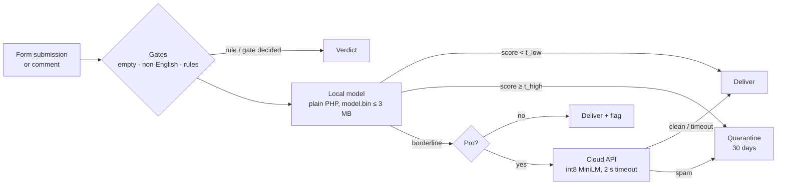

# Architecture essentials

The one-page version of [architecture.md](architecture.md). Read this first; open the full document when you need the detail behind a line.

## The shape of the system

| Part | What it is | Where it runs | Cost to us |
|---|---|---|---|
| **Free plugin** | PHP, GPLv2+, on WordPress.org: integrations, pipeline, quarantine, admin UI | Customer's server | $0 |
| **Local model** | Hashed n-gram logistic regression, `model.bin`, inference in plain PHP | Customer's server | $0 |
| **Pro add-on** | Separate plugin with the Freemius SDK, cloud client and adaptation; attaches via hooks | Customer's server | $0 |
| **Cloud API** | FastAPI + ONNX Runtime, int8 MiniLM-L6, in-process caches, SQLite | One small EU VPS | ~$5–10/month |
| **Training** | Python: dataset merge, featurizer, LogReg, transformer fine-tune, gates | Dev PC (RTX 2060) + Kaggle | $0 |

## Seven rules the code must never break

1. **The free plugin makes no network calls** unless the user opts in to sharing (C1). Freemius lives only in Pro.
2. **Fail open.** Errors, missing model, timeouts → deliver and log. Never drop a message.
3. **Quarantine, never delete on arrival.** Deletion happens only by retention, user action or uninstall.
4. **Escape all spam content on output.** It is attacker-written text displayed in wp-admin. Plain text only, never HTML.
5. **PHP and Python score identically** (to 4 dp), proved by shared fixtures in CI.
6. **Local classification stays under 20 ms and 16 MB.** Weights are never unpacked into a PHP array.
7. **Every verdict stores its model version.**

## Five decisions that make it work

| Decision | Why it matters |
|---|---|
| **Own featurizer with `crc32`**, written twice (PHP + Python) | sklearn's hashing uses Murmur3, which PHP 7.4 lacks. `crc32` is identical in both languages. Lowercasing is ASCII-only because `strtolower` is locale-dependent before PHP 8.2. |
| **Binary `model.bin`**: 2^19 float32 weights (2 MB) + JSON header | `unpack('g', $blob, $offset)` reads only the 300–2,000 buckets a message uses, so memory stays at about 2 MB. |
| **Platt calibration, and thresholds shipped inside the model** | Calibrated scores (M4). User overrides are stored as offsets, so they survive model updates. |
| **Pro attaches through the public `laas_verdict` filter** | The free plugin has no Pro code paths, which keeps it inside directory rules. Third parties get the same power. |
| **MiniLM-L6 int8 on CPU, one process, no Redis/Postgres** | Meets 300 ms p95 on a ~€5 box. 1,000 Pro sites ≈ 2k–10k requests/day. |

## Data at rest (on the customer's site)

- `laas_quarantine`: held messages with score, reason, top features, model version and release payload. Indexed by date, verdict and status.
- `laas_rules`: allow and block lists (email, domain, IP, phrase). Plain substring matching, no user regex.
- `laas_stats_daily`: counts only. Powers the dashboard widget, the upgrade prompt and agency counts.
- Everything is removed on uninstall. Held messages expire after 30 days by default.

## Integrations (v1)

| Form plugin | Hook | Release difficulty |
|---|---|---|
| Contact Form 7 | `wpcf7_spam` | **High**: CF7 stores nothing, so the plugin keeps the payload and rebuilds the mail. Spike it first. |
| WPForms | Its spam-check filter (confirm) | Medium |
| Comments | `pre_comment_approved` → `'spam'` | Low: core keeps the comment |

## The ML loop

`sources → schema (D1 + template_id, licence, split_policy) → dedupe (exact + MinHash) → group split by source/template → LogReg + Platt → model.bin + parity fixtures → gates on the real hand-labelled set (Wilson CIs) → ship`

The gates are FPR ≤ 0.5% (local) and ≤ 0.3% (cloud), recall targets, ECE ≤ 5%, no regression, and beating a keyword baseline. If any gate fails, nothing ships.

## Where to go next

- Build order and repo layout: [architecture.md §2](architecture.md#2-repository-layout)
- Model file and PHP inference: [architecture.md §4](architecture.md#4-local-model-format-and-php-inference)
- Threats and controls: [security-analysis.md](security-analysis.md)
- Screens and copy: [design.md](design.md)
- How agents and contributors work in this repo: [agents.md](agents.md)
