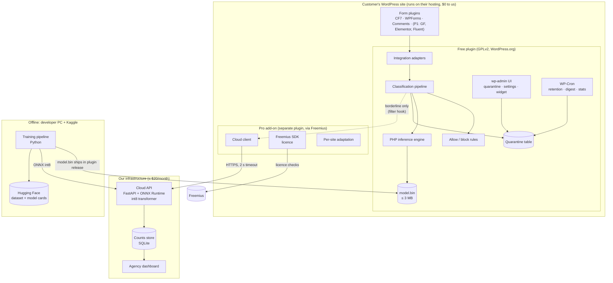
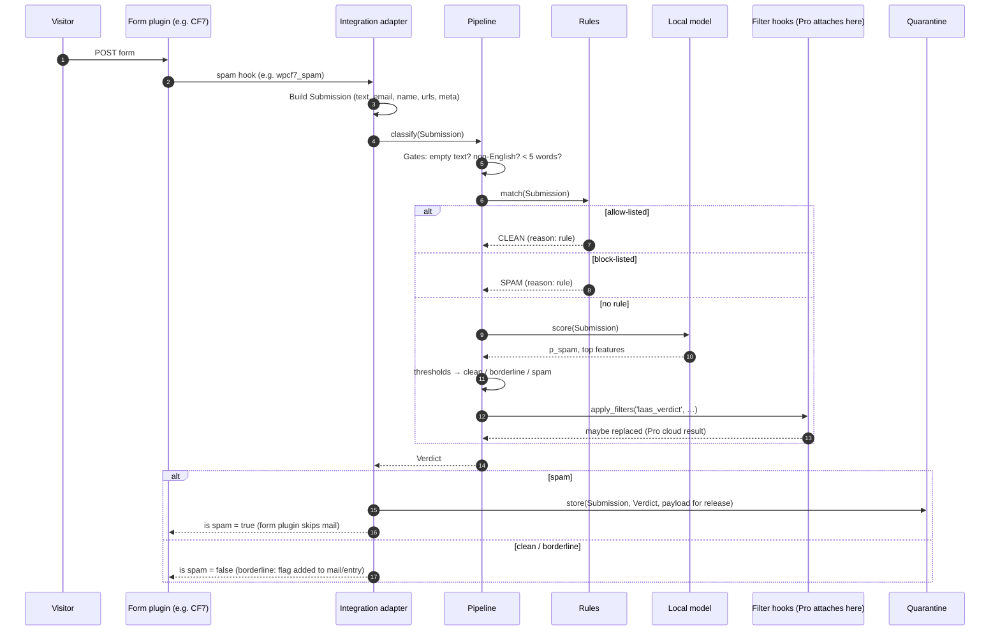
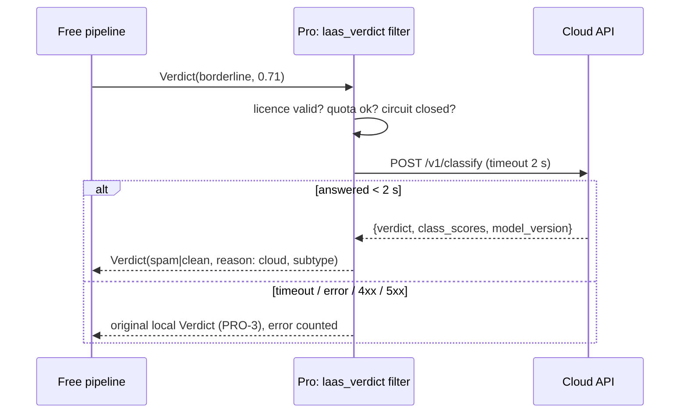
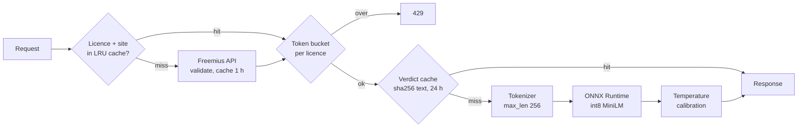
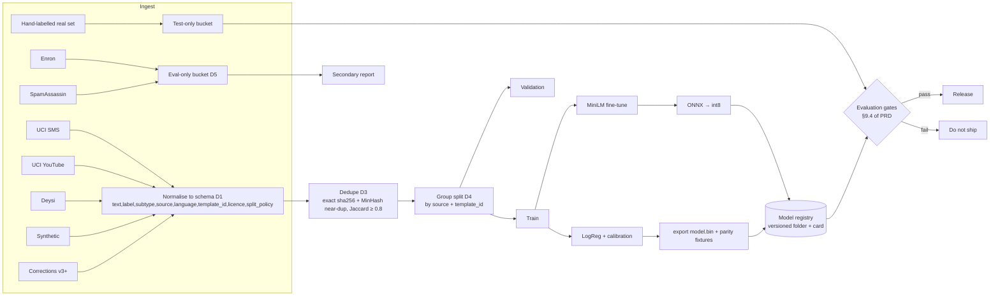

# Architecture

**Status:** design baseline for v1 (written before any code exists).
**Reads with:** [PRD.md](PRD.md) for the *what*, [architecture-essentials.md](architecture-essentials.md) for the one-page version, [security-analysis.md](security-analysis.md) for the threat model.

Requirement IDs (F1, PRO-1, M3, T4, C1 …) refer to [PRD.md](PRD.md). Decisions that settle a PRD open question or a review note (R1–R10) are marked **Decision**.

---

## 1. System overview

The product has three runtime systems and one offline system. Most of the value comes from the system that costs us nothing to run.



**Invariants that the architecture enforces**

1. **The free plugin never opens a network socket** unless the user has opted in to sharing corrections (C1). The Freemius SDK and the cloud client live only in the Pro add-on (R3).
2. **Fail open.** Any exception, missing file, timeout or unexpected state ends in *deliver* plus a log entry, never in *drop* (F12, PRO-3).
3. **Quarantine, never delete on arrival** (F6). The only deletions are retention expiry, a user action and uninstall.
4. **The free plugin works without Pro.** Pro attaches only through the free plugin's public hooks (F17), so the free plugin has no Pro code paths at all.
5. **Every verdict records the model version** that produced it (T7).

## 2. Repository layout

One monorepo, so the parity tests can run PHP and Python against the same fixtures in one CI job.

```
/
├── plugin/                     # Free plugin: what ships to WordPress.org (GPLv2+)
│   ├── local-ai-anti-spam.php  # Bootstrap: header, constants, autoloader, hooks
│   ├── uninstall.php           # Drops tables and options (C5, T2)
│   ├── readme.txt              # WordPress.org listing (L1–L6)
│   ├── src/
│   │   ├── Plugin.php          # Service container + hook registration
│   │   ├── Classifier/         # Pipeline, Verdict, Thresholds, LanguageGate
│   │   ├── Inference/          # Featurizer, ModelFile, LogisticModel (pure PHP, no WP deps)
│   │   ├── Rules/              # Allow/block lists
│   │   ├── Quarantine/         # Repository, Releaser, Retention
│   │   ├── Integrations/       # Cf7.php, WpForms.php, Comments.php, … (one adapter per form plugin)
│   │   ├── Admin/              # Screens, list tables, settings, notices, dashboard widget
│   │   ├── Privacy/            # Policy text, exporter, eraser (C6)
│   │   └── Sharing/            # Opt-in correction sharing (F16, C2, C3)
│   ├── model/
│   │   └── model.bin           # Weights artefact produced by /training
│   ├── languages/
│   └── tests/                  # PHPUnit (unit + WP integration)
├── pro/                        # Pro add-on (separate plugin, sold through Freemius)
│   ├── local-ai-anti-spam-pro.php
│   ├── freemius/               # Freemius SDK (vendored)
│   └── src/                    # CloudClient, Adaptation, Summary
├── inference-php/              # Standalone open library (mirror of plugin/src/Inference) for Packagist
├── training/                   # Python: data, featurizer, training, export, evaluation
│   ├── laas/                   # Package: schema, ingest, dedupe, split, featurize, train, export
│   ├── synth/                  # Synthetic generator prompts + templates
│   ├── eval/                   # Gates, reports, keyword baseline
│   └── tests/
├── cloud-api/                  # FastAPI service + Dockerfile + Caddyfile
├── parity/                     # Shared fixtures: inputs + expected scores (JSON); both test suites read them
├── site/                       # Static product site (per-form-plugin landing pages)
└── document/                   # This documentation
```

**Code prefix.** PHP namespace `LocalAIAntiSpam\`; function, option, hook, table and transient prefix `laas_` (WordPress.org reviewers reject short prefixes). Rename everything in one pass once the product name is final.

## 3. The classification pipeline (free plugin)

### 3.1 Request path



The entire pipeline runs inside `try { … } catch (\Throwable $e)`. The catch logs the error (`laas_log`, a capped ring buffer in an option) and returns `Verdict::failOpen()`, which counts as clean.

### 3.2 Submission and verdict objects

```php
final class Submission {
    public string $source;      // 'cf7' | 'wpforms' | 'comment' | …
    public string $formId;      // form ID or comment post ID
    public string $text;        // concatenated free-text fields, capped at 8,000 bytes
    public ?string $email;
    public ?string $name;
    public ?string $ip;         // used only for rules; stored per the "store IP" setting
    public array $urls;         // extracted from text + URL fields
    public array $payload;      // integration-specific data needed to release later (R6)
}

final class Verdict {
    public string $label;       // 'clean' | 'borderline' | 'spam' | 'unchecked'
    public float  $score;       // calibrated P(spam), 0..1
    public string $reason;      // 'model' | 'rule:allow' | 'rule:block' | 'cloud' | 'lang' | 'short' | 'error'
    public array  $topFeatures; // [['token' => 'backlinks', 'weight' => 1.42], …] (max 8)
    public string $modelVersion;// e.g. 'local-2026.11.1' or 'cloud-minilm-2026.12.0'
    public ?string $subtype;    // Pro only: 'solicitation', 'crypto', …
}
```

### 3.3 Gates, applied before the model

| Gate | Condition | Outcome | PRD |
|---|---|---|---|
| No text | No free-text field, or empty after trimming | `unchecked`, deliver | Edge case |
| Not English | Language gate fails (below) | `unchecked`, deliver, label "not checked" | Edge case |
| Rule match | Allow or block list hit | `clean` or `spam`, reason `rule:*` | F9 |
| Short | Fewer than 5 words | Score with sender and link features only; spam threshold raised by +0.05 (lean deliver) | Edge case |

**Language gate (no `intl`, no external library).** Two cheap tests: (a) at least 70% of letters are ASCII `a-z`, and (b) at least 2 hits in a 150-word English stop-word set, or the text has fewer than 8 words. This errs towards "English", so non-English text is treated conservatively. A message that fails the gate is delivered, not quarantined.

### 3.4 Thresholds and verdicts

Two thresholds: `t_low < t_high`. `score < t_low` → clean; `score ≥ t_high` → spam; otherwise borderline.

- **Defaults come from evaluation, not from guesses.** `t_high` is set to the lowest threshold that keeps the false-positive rate (FPR) at 0.5% or lower on the real test set, using the upper end of its Wilson interval (R4). `t_low` is set so that about 10–20% of real traffic falls in the borderline band. Placeholders until month 2: `t_low = 0.50`, `t_high = 0.92`.
- **The defaults ship inside `model.bin`**, so a model update carries thresholds calibrated for it. User overrides are saved as *offsets* from the model defaults, so they survive model updates.
- Settings show a three-step slider (Relaxed / Balanced / Strict) mapped to offsets of +0.04, 0 and −0.04 on `t_high`, plus an "advanced" field for exact values.

| Verdict | Free plan | Pro plan |
|---|---|---|
| clean | Delivered | Delivered |
| borderline | Delivered; tagged `[Possible spam]` in the subject (configurable) and counted | Sent to the cloud; the cloud verdict decides; on timeout, treated as free plan |
| spam | Quarantined; form plugin told "spam" | Quarantined (solicitation goes to its own folder when that class is on) |

## 4. Local model format and PHP inference

This section resolves review notes R1 (memory) and R2 (hash parity).

### 4.1 Featurizer (identical in PHP and Python)

Write it twice, keep it small, and pin it with the parity fixtures.

1. **Normalise.** Remove zero-width and format characters (`U+200B–U+200F`, `U+2060`, `U+FEFF`); fold a small homoglyph table (Cyrillic/Greek look-alikes → Latin); collapse runs of whitespace; ASCII-only lowercase through a fixed `A–Z → a–z` map (`strtr`). Do **not** use `strtolower` (locale-dependent before PHP 8.2) or `mb_*` (mbstring is not guaranteed).
2. **Replace entities with tokens.** URLs → `__url__` and `__dom_<registrable-domain>__`; emails → `__email__`; phone-number patterns → `__phone__`; numbers → `__num__`. All regexes are linear-time (no nested quantifiers) and run on input already capped at 8,000 bytes.
3. **Word features.** Split on `[^a-z0-9_']+`; emit unigrams `w:<tok>` and bigrams `b:<tok1>_<tok2>`.
4. **Character features.** On the first 3,000 bytes of the normalised text, with a space added at each end, emit byte 3-, 4- and 5-grams `c:<gram>`. Use bytes, not code points, so PHP `substr` and Python `bytes` slicing agree exactly. The 3,000-byte cap keeps an 8 KB message inside the latency budget; word features still cover the full 8,000 bytes.
   - **Regex rule:** use ASCII-only classes and write vertical tab as `\x0b`, never `\v`. In PCRE `\v` means "any vertical whitespace", including byte `0x85`, which occurs inside UTF-8 characters such as "Å". Python reads `\v` as the single character U+000B, so the two engines would match different spans.
5. **Hash.** `h = crc32(feature_string)` (IEEE CRC-32: PHP `crc32()` and Python `zlib.crc32()` return the same unsigned value on 64-bit builds). Bucket `= h & (2^19 − 1)`; sign `= (h >> 31) ? −1 : +1`. Values are term counts, then `log1p`, then L2-normalised per feature family (word, char).
6. **Dense features (M2)**, appended after the hashed buckets: `link_count` (capped at 10, then /10), `distinct_link_domains`, `caps_ratio`, `log_length`, `email_domain_matches_link_domain` (0/1), `has_email_field` (0/1), `short_message` (0/1). They are standardised with means and standard deviations stored in the header.

### 4.2 Model file `model.bin`

Little-endian binary. It is not JSON, because JSON would be too large and slow to parse.

| Offset | Field | Type |
|---|---|---|
| 0 | Magic `LAAS` | 4 bytes |
| 4 | Format version | uint16 |
| 6 | Header length *H* | uint32 |
| 10 | Header (UTF-8 JSON: `model_version`, `n_buckets`, `dense_names`, `dense_means`, `dense_stds`, `bias`, `platt_a`, `platt_b`, `t_low`, `t_high`, `featurizer_version`, `sha256_of_weights`, `trained_at`, `metrics`) | *H* bytes |
| 10+*H* | Hashed weights: `n_buckets` × float32 | 2,097,152 bytes for 2^19 |
| … | Dense weights: `len(dense_names)` × float32 | small |

**Size:** 2^19 float32 weights = 2.0 MB plus a header of about 2 KB, which is under the 3 MB limit (M3). If 2^19 buckets prove too few (many collisions), switch to 2^20 with int8 weights and a per-block scale, which is 1.0 MB. The format version field allows this change without breaking older readers.

### 4.3 PHP inference: never materialise the weights

```php
// Pseudocode, LocalAIAntiSpam\Inference\LogisticModel
$blob = file_get_contents($path);              // ~2 MB string: the only large allocation
$base = 10 + $headerLen;
$z    = $header['bias'];
foreach ($features as $bucket => $value) {     // typically 300–2,000 active features
    $w  = unpack('g', $blob, $base + 4 * $bucket)[1]; // 'g' = float32 LE; offset arg needs PHP 7.1+
    $z += $w * $value;
}
$z += dot($denseWeights, $denseFeatures);
$p  = 1 / (1 + exp(-($header['platt_a'] * $z + $header['platt_b'])));   // Platt calibration (M4)
```

- **Memory:** about 2 MB for the blob plus a few hundred KB for features. That is under the 16 MB budget. This is the R1 resolution.
- **Time:** about 2,000 `unpack` calls take roughly 0.5–2 ms on shared hosting, and featurisation takes another 1–5 ms. The expected total is well inside 20 ms, and CI enforces the budget with a benchmark test.
- **Lazy load:** the blob is read only inside `classify()`, never on page load. It is kept in a static property for the rest of the request.
- **Integrity:** on first load after an update, check the header `sha256_of_weights` (`hash('sha256')` is in core PHP) and cache the result in a transient keyed by plugin version. A mismatch means fail open and an admin notice.
- **Explanations (F7):** for each feature, contribution = `w × value`. Keep the top 8 positive contributions. The featurizer keeps a `bucket → original string` map for the current message only, so the UI shows real words such as `backlinks` and `guest post` rather than bucket numbers. Character n-gram contributions are folded into the word that contains them.

### 4.4 Python side (`training/laas/featurize.py`)

The same featurizer written in pure Python, not `HashingVectorizer` (R2). It produces a `scipy.sparse` CSR matrix for scikit-learn. `export.py` writes `model.bin` and `parity/fixtures.json`, about 500 inputs with the expected score from Python. PHPUnit asserts `abs(php - py) < 5e-5`, which meets M3's four decimal places, on every fixture. The fixtures deliberately include Unicode, homoglyphs, zero-width characters, empty strings, 8 KB inputs and URL-heavy text.

## 5. Integrations

Each adapter implements one interface. Adapters load only when their form plugin is active, which is detected on `plugins_loaded`.

```php
interface Integration {
    public function id(): string;                 // 'cf7'
    public function isAvailable(): bool;          // e.g. class_exists('WPCF7')
    public function register(): void;             // add_filter(...) for the spam hook
    public function release(QuarantineItem $i): ReleaseResult;  // re-deliver (F8)
    public function registerMarkSpamAction(): void;             // "Mark as spam" in that plugin's list (F8)
}
```

| Integration | Spam hook (confirm per T1 in design) | Release strategy | Risk |
|---|---|---|---|
| Contact Form 7 | `wpcf7_spam` filter (return `true` = spam; CF7 then skips mail) | CF7 keeps nothing. Store posted data, form ID and uploaded-file metadata. On release, rebuild the mail from the form's `mail` and `mail_2` templates with the stored values and send it through CF7's mail API or `wp_mail`. Spike this first. | **High** (R6) |
| WPForms | WPForms' spam-check filter in the processing pipeline (candidates to verify: the honeypot or spam-reason filter used by its own anti-spam; entries can be marked as spam in recent versions) | Where WPForms stores spam entries, release = change entry status + re-run notifications through its notification API. Otherwise store the payload the same way as CF7. | Medium |
| Comments | `pre_comment_approved` filter, returning `'spam'` | WordPress already keeps spam comments. Quarantine row references `comment_ID`; release = `wp_set_comment_status($id, 'approve' or 'hold')` + `wp_notify_postauthor`. Retention leaves core's spam purge alone. | Low |
| Gravity Forms (P1) | `gform_entry_is_spam` | GF stores spam entries; release = set entry status to `active` through `GFAPI` + `GFAPI::send_notifications()` | Low |
| Elementor Forms (P1) | Form validation / record hooks (to confirm) | Store payload; resend through the actions | Medium |
| Fluent Forms (P1) | Spam/validation filter (to confirm) | Status change + notification resend | Medium |

**Field mapping.** Each adapter maps the form's fields to `text`, `email`, `name` and `urls`, using field types where the form plugin exposes them (email, textarea, url) and field names as a fallback (`*message*`, `*comment*`, `*email*`). Fields that look like passwords, card numbers or hidden tokens are excluded from `text` and from the stored payload.

**"Mark as spam" for misses (F8).** Add a row action in each form plugin's entry list, and use core's comment "Spam" action. The action writes a correction row, offers block-list entries, and queues sharing if the user opted in.

## 6. Data model

All tables use the `$wpdb->prefix` + `laas_` prefix. They are created with `dbDelta` on activation and on a schema-version bump, and dropped in `uninstall.php`.

### 6.1 `laas_quarantine`

| Column | Type | Notes |
|---|---|---|
| `id` | BIGINT UNSIGNED PK AI | |
| `created_at` | DATETIME (UTC) | indexed |
| `source` | VARCHAR(32) | `cf7`, `wpforms`, `comment`, … |
| `form_id` | VARCHAR(64) | |
| `folder` | VARCHAR(16) | `spam` · `solicitation` (Pro) |
| `status` | VARCHAR(16) | `held` · `released` · `deleted`; indexed with `created_at` |
| `verdict` | VARCHAR(16) | indexed with `created_at` (T2) |
| `score` | DECIMAL(5,4) | |
| `reason` | VARCHAR(32) | |
| `top_features` | TEXT (JSON) | |
| `model_version` | VARCHAR(48) | T7 |
| `sender_email` | VARCHAR(191) | indexed (allow-list lookups, privacy erase) |
| `sender_name` | VARCHAR(191) | |
| `sender_ip` | VARCHAR(45) | nullable; setting "store IP addresses", default on, can be turned off |
| `subject_line` | VARCHAR(255) | first line, for the list view |
| `body` | MEDIUMTEXT | full text shown in detail view |
| `payload` | MEDIUMTEXT (JSON) | data needed to release (R6) |
| `msg_hash` | CHAR(64) | sha256 of normalised text, indexed (dedupe repeated spam) |
| `released_at` | DATETIME NULL | |

### 6.2 `laas_rules`

`id`, `kind` (`email` · `domain` · `ip` · `phrase`), `value`, `action` (`allow` · `block`), `created_at`, `created_by` (user ID), `hits`, `last_hit_at`. Unique on (`kind`, `value`). Rules are loaded once per request with a single `SELECT` and cached in the object cache when one is available. Phrase rules use plain `stripos` matching, not regex, so a user can never enter a pathological pattern. Allow rules win over block rules.

### 6.3 `laas_stats_daily`

`day` (DATE), `source`, `checked`, `clean`, `borderline`, `spam`, `released`, `marked_spam`, `unchecked`, `errors`. PK (`day`, `source`). Incremented with `INSERT … ON DUPLICATE KEY UPDATE`. This feeds the dashboard widget (F13), the upgrade prompt (borderline count, flow 4) and the Pro counts upload. It holds counts only and never any content.

### 6.4 Options

`laas_settings` (one autoloaded array: threshold offsets, retention days, enabled integrations, digest schedule, subject tag, store-IP), `laas_db_version`, `laas_log` (non-autoloaded ring buffer, 200 entries, no message content), `laas_share_queue` (non-autoloaded; exists only when sharing is on).

## 7. Background jobs (WP-Cron)

| Hook | Schedule | Job |
|---|---|---|
| `laas_retention` | daily | Delete `held` rows older than the retention setting (default 30 days), in batches of 500 (F6, C5) |
| `laas_digest` | daily or weekly (setting) | Email the admin a list of new quarantined items with links to review them (F15) |
| `laas_share_flush` | hourly, only if sharing is on | POST the redacted correction queue (F16, C2, C3) |
| `laas_stats_rollup` | daily | Drop stats rows older than 400 days |

Digest links open the item in wp-admin. They are plain links that need a logged-in user with the right capability, and the release still takes a nonce-protected click. The link alone never releases a message (see [security-analysis.md](security-analysis.md)).

## 8. Admin surface

The admin surface is specified in [design.md](design.md). Its architectural constraints:

- **Capability.** `laas_manage_quarantine` is mapped to `manage_options` by default and filterable, so agencies can grant it to editors.
- Every state-changing action is a `POST` with a nonce and a capability check, handled through `admin-post.php` or a REST route under `laas/v1` with `permission_callback`.
- All spam content is escaped at output (`esc_html`, `esc_attr`, `esc_url`) and never passed through `wp_kses_post`. The detail view shows the body as **plain text** in a `<pre>`-style block. This is the top security control (S1 in the security analysis).
- Assets load only on the plugin's own screens (`admin_enqueue_scripts` checks the hook suffix).

## 9. Public developer API (F17)

```php
// Classify arbitrary text (no side effects, no storage).
laas_classify( string $text, array $context = [] ): array;   // ['label','score','reason','model_version','top_features']

// Filters
apply_filters( 'laas_pre_classify', null, $submission );     // return a Verdict to short-circuit
apply_filters( 'laas_score',   $score,   $submission );       // adjust the raw score
apply_filters( 'laas_verdict', $verdict, $submission );       // final say; Pro attaches here
apply_filters( 'laas_submission_text', $text, $source, $raw ); // control which fields are classified
apply_filters( 'laas_thresholds', [ $low, $high ], $source );

// Actions
do_action( 'laas_quarantined', $item_id, $verdict, $submission );
do_action( 'laas_released',    $item_id, $user_id );
do_action( 'laas_marked_spam', $source, $ref_id, $user_id );
```

These hooks are a public contract under semver. Pro uses only these hooks, so a third-party developer can do anything Pro does. A filter callback that throws is caught by the pipeline and treated as fail open.

## 10. Pro add-on



- **Separate plugin**, `local-ai-anti-spam-pro`. It requires the free plugin at a minimum version and shows a notice if that is missing. It ships the Freemius SDK and is distributed through Freemius, not WordPress.org.
- **Cloud client:** `wp_remote_post` with `timeout => 2`, `redirection => 0`, `sslverify => true`. A circuit breaker skips the cloud for 5 minutes after 3 consecutive failures, so a cloud outage costs at most 3 × 2 s of form latency per site before falling back to local-only.
- **Payload:** normalised text capped at 4,000 characters, the dense features, `source`, the plugin and model versions. It never sends the sender's name, email or IP. The sender's email *domain* is reduced to a boolean "matches link domain" before it leaves the site.
- **Per-site adaptation (PRO-6), v1 design:** keep it simple. (a) Shift the site's thresholds with a bounded online update from that site's corrections, limited to ±0.05. (b) Keep a site-local weight delta for at most 2,000 buckets, stored in an option and applied additively. Both are bounded so a careless or malicious admin cannot push the false-positive rate far.
- **Weekly summary (PRO-8)** and **counts upload for the agency dashboard (PRO-7):** once a day, POST the `laas_stats_daily` rows (counts only) to `/v1/sites/stats`.

## 11. Cloud API

**Decision: FastAPI (Python).** It uses the same language as training, and the ONNX Runtime and `tokenizers` Python bindings are first-class.

### 11.1 Endpoint (T3)

```
POST /v1/classify
Authorization: Bearer <licence_key>
X-Site-URL: https://example.com
Content-Type: application/json

{ "text": "...", "features": {...}, "source": "cf7", "plugin_version": "1.2.0", "local_score": 0.71 }

200 → { "verdict": "spam", "label": "solicitation",
        "class_scores": {"enquiry":0.03,"support":0.01,"solicitation":0.88,"bot":0.05,...},
        "p_spam": 0.94, "model_version": "cloud-minilm-2026.12.0", "cached": false }
401 invalid licence · 403 site not activated for licence · 413 too large · 429 rate/quota · 503 overloaded
```

Other routes: `POST /v1/sites/stats` (counts only), `POST /v1/corrections` (opt-in sharing, redacted), `GET /healthz` (for the uptime monitor, T6), and the agency dashboard pages (server-rendered; login by emailed magic link to the licence owner).

### 11.2 Internals



- **One process, no external database for hot paths.** The licence cache, rate limiter (T5) and verdict cache (T4) are in-process (`cachetools` TTL caches). The verdict cache holds `sha256(normalised text) → result`, which is a hash, not the content, so it is consistent with C4. Monthly quota counts for PRO-10 are persisted to SQLite every minute.
- **No content logging (C4).** The access log records method, path, status, latency, licence ID (hashed) and model version only. Request bodies are never logged, and the exception handler strips request data before logging. A unit test asserts that the log output never contains a planted canary string from a request.
- **Concurrency:** Uvicorn with 2 workers, and ONNX Runtime `intra_op_num_threads=1` per worker on a 2-vCPU box. MiniLM-L6 int8 at 256 tokens takes about 10–30 ms per inference on such a CPU. With 10–20% of 20–50 submissions a day borderline, 1,000 Pro sites generate only about 2k–10k requests a day, a tiny load (PRD capacity section).
- **Deployment:** a single small EU VPS (the order of €4–6/month for 2 vCPU/4 GB at Hetzner-class providers; confirm current pricing). Docker Compose runs `api` and `caddy` (automatic TLS). Deploys are `docker compose pull && up -d`, with the image tagged by git SHA so rollback is one command. Uptime is watched by a free external monitor on `/healthz` (T6).
- **Backups:** only the SQLite quota and stats file and the corrections store need backing up, nightly to object storage. The model is rebuilt from the registry.

## 12. Training pipeline (offline)



**Key decisions**

- **Schema (D1) gains three columns**: `template_id` (synthetic) for leak-free splits, `licence` and `split_policy` (`train` · `eval_only` · `test_only`). The loader refuses to put an `eval_only` or `test_only` row into the training set. D5 is enforced in code, not by convention.
- **Dedupe is cross-bucket.** Near-duplicates of test rows are removed from *train*, so the test set stays intact.
- **Synthetic generation:** run a 7B-class open-weights model, 4-bit quantised, which fits the 6 GB RTX 2060. Use at least two different model families with Apache-2.0 or MIT licences that place no conditions on outputs. Verify the licence for the *specific* checkpoint, because licences vary by model size within some families, and exclude licences with use restrictions. The generation grid is business type (≥ 20) × intent (enquiry, support, solicitation, bot, crypto, phishing, adult) × tone × length × quality (typos, broken English). Each prompt template gets a `template_id`. Throughput is roughly 1 sample every 3–5 s locally, so 60k samples take tens of GPU-hours. Use Kaggle sessions for part of it.
- **Local model (M1, M4):** `LogisticRegression(solver='saga', C tuned, class_weight tuned)` on the custom features, then Platt calibration fitted on the validation fold. Platt is only two numbers, so PHP parity is trivial. Isotonic would need a lookup table.
- **Distillation (M5, v2+):** scikit-learn's LogisticRegression takes no soft labels, so each training row is duplicated as (label 1, weight *p*) and (label 0, weight 1−*p*), where *p* is the teacher's probability. The result is mixed with hard labels at a tuned ratio.
- **Cloud model (M6–M8):** MiniLM-L6 by default (R9). It is a multi-class head over the subtypes, with spam probability = 1 − P(enquiry) − P(support). Training uses fp16 AMP, batch 32, max_len 256 and early stopping on validation FPR at fixed recall. Export with `torch.onnx.export`, quantise with ONNX Runtime dynamic int8, and compare recall against fp32 on the test set (gate: loss < 0.5 points).
- **Evaluation (§9.4):** report FPR and recall at the operating threshold with **Wilson 95% intervals** (R4), expected calibration error (10 bins), the keyword-rule baseline, and the previous model. A per-source breakdown shows the synthetic-to-real gap. All of this lives in `eval/report.md`, which is generated and committed with each model version.
- **Reproducibility:** fixed seeds, a lock file, and dataset manifests (row counts + sha256 per source file) committed. The model card records the git SHA and manifest hash. The real test set is never committed to a public repo (consent).

## 13. Model release flow

1. Train, export and run the gates. If any gate fails, the version does not ship.
2. Copy `model.bin` into `plugin/model/`. CI runs the parity suite, the latency benchmark and Plugin Check (T8).
3. Add a changelog entry with the measured FPR and its interval (L6), then bump the plugin version.
4. **Pro first (PRO-9):** the cloud image is tagged and deployed. The Pro add-on can fetch a newer `model.bin` from the cloud. This happens only in Pro, under the licence, and is signature-checked (see security analysis S6).
5. Free release through SVN to WordPress.org (F18).

## 14. Observability

| Where | What | How |
|---|---|---|
| Plugin | Errors, fail-open events | `laas_log` ring buffer shown under Settings → Diagnostics; counted in `laas_stats_daily.errors` |
| Plugin | Classification latency | Measured per call; p50/p95 of the last 200 shown in Diagnostics, to verify the 20 ms target on real hosts |
| Cloud | Latency p95, error rate, CPU | Prometheus-format `/metrics` on localhost; a daily summary job; alert when p95 > 300 ms or CPU > 60% (capacity rule) |
| Cloud | Uptime | External free monitor on `/healthz` (T6) |
| Product | Installs, ratings | WordPress.org stats (the free plugin itself sends no telemetry, per C1) |
| Model | Real-world FPR | Release rate ("Not spam" clicks ÷ quarantined) from opted-in sites and from Pro counts uploads. This feeds the kill criterion "FPR above 1% after v2" |

## 15. Compatibility and constraints

- **PHP 7.4–8.4** and **WordPress 6.0+** (F11). CI runs a matrix of PHP 7.4, 8.1 and 8.3 × WordPress 6.0 and latest. The code uses no PHP 8-only syntax: no union types, `match`, named args, `readonly`, enums or constructor promotion. Typed properties are fine on 7.4.
- **Extensions used:** core only (`json`, `hash`, `pcre`, plus the core `crc32()` function). No `mbstring`, `intl` or `curl` dependency; HTTP goes through `wp_remote_*`.
- **Multisite:** tables are per-site, and activation iterates sites when network-activated.
- **Caching plugins:** classification runs on POST, which page caches do not serve, so no interaction is expected.

## 16. Decisions log

| # | Decision | Why | Alternatives rejected |
|---|---|---|---|
| A1 | Custom crc32 featurizer in both languages | Exact PHP/Python parity on PHP 7.4 (R2) | sklearn `HashingVectorizer` (Murmur3, no PHP 7.4 equivalent) |
| A2 | Binary `model.bin`, weights read with `unpack` at offsets | Memory under 16 MB (R1) | JSON or PHP array (too large); `fseek` per feature (syscall overhead) |
| A3 | Platt calibration | Two parameters, trivial parity | Isotonic (lookup table, harder parity) |
| A4 | Freemius only in the Pro add-on | C1 and directory rules (R3) | Freemius in the free plugin in anonymous mode (still makes calls) |
| A5 | FastAPI + in-process caches + SQLite | ≤ $20/month, one developer, small load | Node (splits the language stack); Redis/Postgres (cost and operations for no gain at this scale) |
| A6 | MiniLM-L6 as the default cloud model | Meets 300 ms p95 on a cheap CPU (R9) | ModernBERT-base (revisit if it wins month 2 by a clear margin) |
| A7 | Threshold overrides stored as offsets | Survive model updates that re-calibrate | Absolute values (silently wrong after an update) |
| A8 | Monorepo with shared `parity/` fixtures | One CI job proves PHP ≡ Python | Separate repos (parity drift); `inference-php/` is mirrored out for Packagist |
