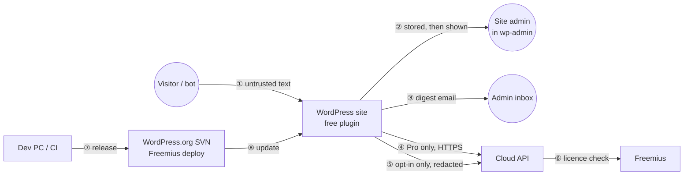

# Security analysis

Threat model and required controls for the free plugin, the Pro add-on, the cloud API and the training pipeline. It is written before implementation so the controls are designed in, not bolted on.

**Reads with:** [architecture.md](architecture.md) (components referenced here), [PRD.md](PRD.md) §13 (privacy requirements C1–C7).
**Not legal advice.** Privacy text and the data-processing agreement need review before launch (PRD §13).

---

## 1. What we protect

| Asset | Why it matters | Where it lives |
|---|---|---|
| **Real enquiries** (availability) | A lost lead is the worst product failure (Goal 2) | Form plugin → our pipeline → inbox / quarantine |
| **Visitor personal data** (confidentiality) | Names, emails, phones, IPs and message text; GDPR/UK GDPR apply to the site owner, and to us for Pro processing | `laas_quarantine`, digest emails, cloud requests, shared corrections |
| **wp-admin integrity** | The quarantine screen shows attacker-written text to administrators | Admin screens, emails |
| **The site owner's trust in "local"** | Privacy is the product's main selling point (PRD §13) | Free plugin network behaviour |
| **Model integrity** | A tampered model can silently drop leads or let spam through | `model.bin`, cloud ONNX model, training data |
| **Licence keys and cloud capacity** | Revenue, and the $20/month cost cap | Pro add-on, cloud API |
| **Consented correction data** | Legal basis for model v3; a leak would be a breach | Cloud corrections store |

## 2. Adversaries

| Actor | Capability | Goal |
|---|---|---|
| **Spammer / bot operator** (most likely) | Submits arbitrary text to any public form, at volume; can iterate against the free model, because the weights are public | Get spam delivered; or get code to run in wp-admin |
| **Targeted attacker** | Crafts a specific payload for one site | Stored XSS → admin session → site takeover |
| **Competitor / malicious site owner** | Has a valid free install or Pro licence | Poison shared corrections; abuse or drain cloud quota; scrape the cloud model |
| **Network attacker** | Sits on the path between the site and the cloud | Read or modify cloud traffic |
| **Supply-chain attacker** | Compromises a dependency, the dev machine, or the release account | Ship malicious plugin code to every install |
| **Curious insider / future us** | Server access | Read message content that should not have been retained |

## 3. Trust boundaries

Every arrow is a boundary. ①, ④ and ⑦ carry the most risk.

## 4. Threats and controls (STRIDE by component)

Severity combines likelihood and impact: **Critical** → must be fixed before any release; **High** → before launch; **Medium** → before or soon after launch; **Low** → track.

### 4.1 Free plugin

| ID | Threat | STRIDE | Sev. | Required controls |
|---|---|---|---|---|
| **S1** | **Stored XSS via spam content.** A spammer submits `<script>`, ``, `javascript:` URLs, or payloads in the *name*, *email* or *subject* fields. These are rendered in the quarantine list, detail view, dashboard widget or digest, and run in an admin's session. | T, E | **Critical** | Escape at output, always: `esc_html()` for text, `esc_attr()` for attributes, `esc_url()` only for *our* URLs. Render the message body as plain text (escaped, `white-space: pre-wrap`). Never `wp_kses_post` or `wpautop` spam content. Never make spam URLs clickable. Store raw input and escape late. Unit tests feed an XSS corpus (OWASP cheat-sheet vectors, plus polyglots) through every render path and assert that no unescaped `<` reaches the output. Run Plugin Check's escaping sniff with zero exceptions. |
| **S2** | **CSRF on state-changing actions** (release, delete, add rule, change settings). | T | High | Every action is a POST with `wp_nonce_field` / `check_admin_referer`, or a REST route with `permission_callback`. No state change happens on GET. |
| **S3** | **Missing or incorrect authorisation.** A subscriber or a logged-out user reaches the release or settings handlers through `admin-ajax.php` or REST. | E | High | Check `current_user_can('laas_manage_quarantine')` in every handler. Do not register `wp_ajax_nopriv_*` handlers. REST `permission_callback` is never `__return_true`. Tests call every handler as subscriber and as anonymous and expect 403. |
| **S4** | **Release via digest link.** A forwarded or leaked digest email lets anyone release or read messages. | S, I | Medium | Digest links only open wp-admin (login required). There is no tokenised one-click release. Digest content is escaped and truncated, and never includes spam links. |
| **S5** | **SQL injection** through search, sort or filter parameters. | T, I | High | `$wpdb->prepare()` for all values. Sort columns and order come from an allow-list. Use `esc_like()` for `LIKE`. Tests include injection strings in every parameter. |
| **S6** | **Model tampering.** `model.bin` is replaced (compromised host, or a malicious Pro update) so that real leads are dropped or spam passes. | T | Medium | The header carries `sha256_of_weights`, checked on first load per version. A mismatch means fail open and an admin notice. Pro-fetched models are **signed** (Ed25519; the public key is shipped in the Pro plugin; verified with `sodium_crypto_sign_verify_detached`, which WordPress provides on every host through its bundled `sodium_compat`) before replacing the bundled file. The free plugin never downloads models; it updates only through WordPress.org (F18). |
| **S7** | **Denial of service through input.** Huge submissions, ReDoS in URL/email regexes, or hash flooding slow form handling or exhaust memory. | D | High | Cap the text at 8,000 bytes before any processing. All regexes are linear (no nested quantifiers) and run under `pcre.backtrack_limit`; on a PCRE error, skip that feature and do not fail. User-entered phrase rules use `stripos`, never regex. A benchmark test on worst-case inputs asserts < 20 ms. |
| **S8** | **Fail-closed bug drops leads.** An exception or fatal error is handled in a way that tells the form plugin "spam", or crashes the submission. | D | **Critical** (product) | One top-level `try/catch (\Throwable)` per integration returns *not spam*. Integration tests simulate a missing model, a corrupt model, a DB failure and a filter callback that throws, and assert that the mail is still sent. |
| **S9** | **Evasion of the local model.** The weights are public (by design), so spammers can optimise text against them: homoglyphs, zero-width characters, leetspeak, padding with "ham" words. | T | Medium (accepted) | Normalisation removes zero-width characters and folds homoglyphs. Character n-grams resist small perturbations. Dense features (links, domains) are hard to evade without hurting the spam's own purpose. Pro's cloud model is not public. Model updates ship regularly. **Accepted risk:** a determined adversary can beat a public linear model; the product's promise is better than rules and good enough for small sites, not unbeatable. |
| **S10** | **Personal-data handling.** Quarantine stores PII indefinitely, survives uninstall, or is missing from export and erase requests. | I | High | Retention cron (default 30 days). `uninstall.php` drops tables and options (and does so per site on multisite). Register `wp_privacy_personal_data_exporters` and `_erasers` keyed on `sender_email` (C6). Suggested privacy-policy text via `wp_add_privacy_policy_content`. Option "store IP addresses" with honest copy. The log never contains message content. |
| **S11** | **Unexpected outbound calls** break C1. Examples: an accidental remote font or script, a library that phones home, or the Freemius SDK leaking into the free build. | I | High (trust) | CI test: run the free plugin's test suite with `pre_http_request` set to fail on any call while sharing is off. A build script refuses to package if `freemius/` or external URLs in enqueued assets appear in `plugin/`. |
| **S12** | **Header and mail injection on release.** Stored values (name, email, subject) are placed into mail headers when re-delivering. | T | Medium | Build headers only from validated values (`is_email()`, strip CR/LF from every header field) and send through `wp_mail()`. Reuse the form plugin's own templates where possible (CF7 mail tags), not string concatenation. |
| **S13** | **Allow-list abuse.** A spammer learns that a frequent legitimate sender is allow-listed and spoofs that address. | S | Low | Allow-by-email is weaker than it looks, because the From address is attacker-controlled on forms. Recommend allow-by-*phrase* or domain in the UI. Show the rule that matched in the reason view so abuse is visible. |
| **S14** | **Correction sharing leaks PII** (C3). | I | High | Redaction runs on-site before queueing: remove form name/email/phone fields entirely; regex-redact emails, phone numbers and URLs with query strings in the text; drop IPs; strip the site URL. Show a preview of exactly what will be sent in Settings → Privacy. Sharing is off by default and only queues corrections made after opt-in. |

### 4.2 Pro add-on

| ID | Threat | STRIDE | Sev. | Required controls |
|---|---|---|---|---|
| **S15** | **Licence key exposure.** The key is stored in the DB and could be shown to non-admins or in logs. | I | Medium | Stored by Freemius in its own options. Never echoed in full in the UI (last 4 characters only), and never logged. |
| **S16** | **MITM on cloud calls.** | T, I | High | HTTPS only, `sslverify => true`, no redirects followed. The URL is hardcoded and only overridable by a constant for testing. |
| **S17** | **Cloud outage or slowness degrades forms.** | D | Medium | 2 s timeout, a circuit breaker (3 failures → 5 minutes local-only), fall back to the local verdict (PRO-3). |
| **S18** | **Per-site adaptation is pushed to hold everything**, by a careless or malicious admin. | T | Low | Threshold shift bounded at ±0.05; local weight delta capped (2,000 buckets, bounded magnitude); "Reset learning" button. |

### 4.3 Cloud API

| ID | Threat | STRIDE | Sev. | Required controls |
|---|---|---|---|---|
| **S19** | **Content retention** breaks C4: request bodies end up in access logs, error trackers, crash dumps or the cache. | I | High | No body logging at any layer (Uvicorn, Caddy, app). The exception handler scrubs request data. The verdict cache keys on a SHA-256 hash and stores only the verdict. No third-party error tracker receives payloads. A unit test plants a canary string and greps all logs for it. Swap is disabled or encrypted on the VPS. |
| **S20** | **Licence abuse:** a key shared across sites, quota draining, or scraping the model to distil it. | S, D | Medium | Each key is bound to the activated site URLs (403 otherwise). A token bucket per licence (for example 5 req/s with a burst of 20) plus monthly quotas (PRO-10). Only borderline requests are expected, so alert on licences with a high volume of confidently clean or spam requests (a scraping signal). Responses round scores to 2 decimals. |
| **S21** | **Unauthenticated access / enumeration.** | S | High | Bearer key required on every route except `/healthz`. Constant-time comparison against the cached hash. Failed auth is rate-limited per IP (fail2ban-style in-process). |
| **S22** | **Request-size and parser DoS.** | D | Medium | Caddy body limit 32 KB; the app rejects text > 4,000 characters with 413; the tokenizer truncates at 256 tokens; worker timeouts. |
| **S23** | **Server compromise.** | E | High | Minimal VPS: SSH keys only, no root login, unattended security upgrades, firewall allowing 22/80/443 only (22 restricted if possible). Containers run as non-root with a read-only filesystem except the data volume. The model-signing private key is **never** on the server; it stays offline on the dev machine. The Freemius API credentials on the server are scoped to licence validation only. |
| **S24** | **Agency dashboard exposure:** cross-tenant data leaks between agencies. | I | High | Every query is scoped by the authenticated licence ID. Magic-link login tokens are single-use and expire in 15 minutes. Only counts are stored, never content. Session cookies are `Secure`, `HttpOnly`, `SameSite=Lax`. Tests check that agency A cannot read agency B's sites. |
| **S25** | **Poisoning via shared corrections.** A malicious opted-in site uploads mislabelled messages to make future models allow spam or hold leads. | T | Medium | Corrections never train automatically. Per-site contribution caps; down-weight sites whose labels disagree strongly with the model and with other sites; hold out a slice for manual review; and the evaluation gates on the real hand-labelled set catch regressions before release. |

### 4.4 Training pipeline and release

| ID | Threat | STRIDE | Sev. | Required controls |
|---|---|---|---|---|
| **S26** | **Licence contamination:** eval-only data or a restricted generator's output leaks into production training. | Legal | Medium | `split_policy` is enforced in the loader (raises an error, does not just warn). The manifest records every source with its licence. The dataset card lists them (D7). |
| **S27** | **Consent breach:** the real hand-labelled test set is published or committed. | I | High | The test set lives outside the repo (`.gitignore`d path) and is encrypted at rest. Only aggregate metrics are published. |
| **S28** | **Supply chain:** a compromised Python or PHP dependency, or a malicious model download (pickle). | T, E | Medium | Pin and hash dependencies (lock files with hashes). Load Hugging Face checkpoints with `safetensors` only, never pickle. The free plugin has **zero** runtime Composer dependencies. Dependabot or `pip-audit` / `composer audit` in CI. |
| **S29** | **Release account takeover** (WordPress.org SVN, Freemius, GitHub, domain registrar). | E | High | 2FA on every account; unique passwords in a manager; release from CI with a tagged, reviewed commit; Plugin Check and the test suite gate the release. |

## 5. Privacy requirements traced to controls

| Req. | Control(s) | Verified by |
|---|---|---|
| C1 no outbound calls | S11 | CI test blocking `pre_http_request` |
| C2 opt-in, clear consent | Settings → Privacy copy (design.md §3.7), off by default | UI test + review |
| C3 redaction before sharing | S14 | Unit tests on the redactor with PII fixtures |
| C4 no content logs in cloud | S19 | Canary-string log test |
| C5 retention + uninstall cleanup | S10 | Integration tests on cron and `uninstall.php` |
| C6 policy text, export, erase | S10 | Integration tests through the core privacy tools |
| C7 DPA for EU/UK | Document template; EU-hosted VPS; sub-processors listed (hosting provider, Freemius) | Legal review |

## 6. Pre-release security checklist

Run for every free and Pro release. All items must pass.

- [ ] Plugin Check: zero errors, zero escaping or nonce warnings.
- [ ] PHPCS with the WordPress-Extra security sniffs: clean.
- [ ] XSS corpus test through every render path (list, detail, widget, digest, notices): passes.
- [ ] Authorisation matrix test (admin / editor / subscriber / anonymous × every handler): passes.
- [ ] No-outbound-call test (free build, sharing off): passes.
- [ ] Fail-open tests (missing model, corrupt model, DB error, throwing filter): mail still delivered.
- [ ] Worst-case input benchmark: < 20 ms, < 16 MB.
- [ ] `composer audit` / `pip-audit`: no known-vulnerable dependencies.
- [ ] Built zip contains no `freemius/`, `.git`, tests, fixtures with real data, or `.env`.
- [ ] Model file SHA-256 matches the registry; model card and changelog FPR updated.
- [ ] Cloud (if changed): canary log test passes; cross-tenant test passes; TLS configuration rated A or better.

## 7. Incident response (one-person version)

| Event | First hour | Then |
|---|---|---|
| XSS or auth vulnerability reported | Confirm; prepare a fix on a private branch | Release the patch; email the WordPress.org plugins team if it is critical (they can force updates); publish an advisory in the changelog |
| Model drops real leads at scale (FPR spike in release rates) | Ship a hotfix that raises `t_high` via a model header bump | Root-cause; add the failing cases to the test set; consider the kill criterion "FPR > 1%" |
| Cloud API compromised | Take the API offline (Pro falls back to local automatically); rotate the Freemius API keys | Rebuild the server from scratch; notify affected customers within 72 hours if personal data was involved (GDPR) |
| Leaked corrections data | Stop the corrections endpoint | Assess scope; notify contributing sites; supervisory authority notice if required |

Publish a `SECURITY.md` with a contact address and a 90-day disclosure policy. Consider enrolling the free plugin in the WordPress-ecosystem vulnerability disclosure programmes (Wordfence or Patchstack) once it has an install base.

## 8. Accepted risks

| Risk | Why accepted |
|---|---|
| Spammers can optimise against the public local model (S9) | Open weights are a stated product choice (PRD §11). The cloud model, regular updates and non-text features limit the damage. |
| Allow-by-email can be spoofed (S13) | It is needed for usability. The UI steers users to stronger rule types. |
| A single cloud server is a single point of failure | Fail-open design means an outage only reduces Pro accuracy temporarily. There is no uptime guarantee (PRD non-goals). |
